# Лаб 01 — Тайлан

**Сэдэв:** Raspberry Pi 3B/3B+ ба Ubuntu WSL дээр IoT edge–cloud платформ ажиллуулах, MQTT саатал, виртуал флот болон санах ойн нөөцийн хэмжилт  
**Баг:** Team06  
**Туршилтын огноо:** 2026-10-22  
**Тайлан шинэчилсэн:** 2026-11-04

## Гишүүд ба хувь нэмэр

| Гишүүн | Хийсэн ажил (тайланд тусгах санал болгосон хуваарилалт) |
|---|---|
| B231950001 М.Нэргүй | Raspberry Pi, Docker/Mosquitto, MQTT bridge, QoS хэмжилтийн орчны ажиллагаа |
| B231950003 А.Тэлмэн | Ubuntu WSL, Docker cloud, EMQX, InfluxDB3, Grafana панелүүд |
| B231950027 Г.Энхбилгүүн | 50/100/200 төхөөрөмжийн флот, нөөцийн хяналт, хэмжилтийн нэгтгэл |

> **Тэмдэглэл:** Гишүүдийн бодит хувь нэмрийг screenshot-оос ялгах боломжгүй тул хуваарилалтыг багийн гишүүд баталгаажуулна.

**Git commit:** `БАТАЛГААЖУУЛАХ`  
**Tag:** `lab01-done` *(үүссэн эсэхийг баталгаажуулаагүй)*

---

## 0. Хэмжилтийн орчин

| Үзүүлэлт | 🥧 Raspberry Pi (edge) | 💻 Зөөврийн компьютер (cloud) |
|---|---|---|
| Загвар / процессор | **Raspberry Pi 3 Model B Plus Rev 1.4**; Cortex-A53, 4 цөм, 1.2 GHz | Dell; Ubuntu/WSL талд **12 логик процессор**; CPU загвар screenshot-д харагдаагүй |
| RAM (нийт / боломжтой) | **905 MiB / 538 MiB** (11:52:48 суурь); өөр нэг агшинд 529 MiB | Ubuntu/WSL: **7942 MiB / 6383 MiB**; Docker Engine-д харагдсан нөөц **7.8 GB**. Хост Windows-ийн нийт физик RAM энэ зурагт байхгүй |
| OS, цөмийн хувилбар | Debian GNU/Linux 13 (trixie), ARM64; өмнөх SSH banner: `6.18.50+rpt-rpi-v8` (тухайн үеийн) | Windows + Ubuntu WSL 2; Ubuntu дистрибьюшний хувилбар зурагт харагдаагүй |
| Сүлжээ | Pi IP **172.16.158.166**; скрипт **100 Mb/s Ethernet** гэж албан ёсны боломжийг хэвлэсэн, бодит холбоосын төрөл/хурд хэмжигдээгүй | Windows cloud Wi-Fi IP **172.16.157.205**; WSL `eth0` **172.30.95.88** |
| Хадгалалт | microSD **29 GiB**, 23 GiB сул, 20% дүүрсэн; microSD class тодорхойгүй | Ubuntu талд 1007 GiB диск, 954 GiB сул (скриптийн мэдээлэл); физик SSD-ийн загвар баталгаажаагүй |
| Docker хувилбар | **29.9.1**, build `dfc520d` | **29.8.1**, build `4a63305` |
| Үндсэн үйлчилгээ | Mosquitto `eclipse-mosquitto:2.0.22` | EMQX, InfluxDB3, Grafana, Registry, сонголтоор ThingsBoard |
| Төхөөрөмжийн ID | **`team06nte`** | MQTT/InfluxDB-ийн `device` шошго: `team06nte` |

### Хэмжилтийн өмнөх шалгалт

| Шалгалт | Хэмжигдсэн утга | Үнэлгээ |
|---|---|---|
| `vcgencmd get_throttled` | `throttled=0x0` | Хэвийн |
| `vcgencmd measure_temp` | Суурь **55.8 °C**, дараах snapshot **52.6 °C** | 70 °C-аас доош |
| `free -m` → available | **538 MiB** (суурь) | 400 MiB-аас их |
| `timedatectl` / `make check` NTP | **NTP OK** | Хэвийн |
| Swap / cgroup | **2047 MB** swap тохиргоо; `cgroup mem OK` | Хэвийн |
| VS Code сервер таслагдсан эсэх | Зурагт шалгалт байхгүй | **Баталгаажаагүй** |

**Зураг 1.** Raspberry Pi болон Ubuntu cloud-ийн `make check`, `make health`, архитектур, нөөцийн үзүүлэлт.

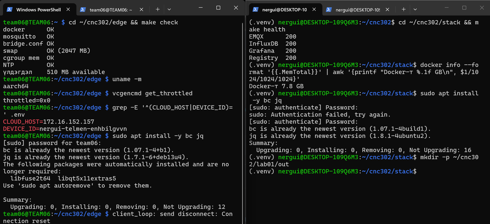

**Зураг 2.** Edge Mosquitto болон cloud үйлчилгээний анхны ажиллагааны snapshot.

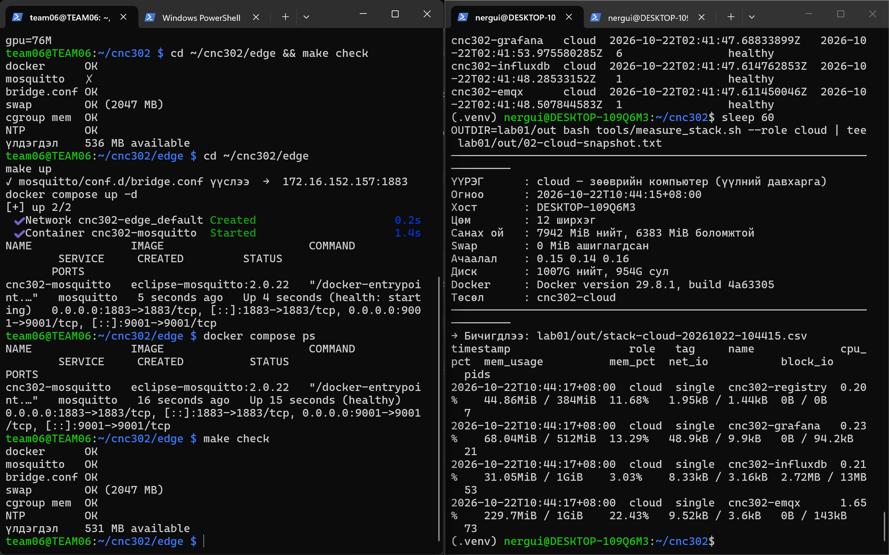

---

## 1. Гүйцэтгэсэн ажил

### 1.1. Raspberry Pi-ийн Mosquitto broker ажиллуулах

```bash
cd ~/cnc302/edge
make up
make check
docker compose ps
```

Зурагт `docker OK`, `mosquitto OK`, `bridge.conf OK`, `swap OK (2047 MB)`, `cgroup mem OK`, `NTP OK` гэж гарсан. Mosquitto `Up (healthy)` төлөвтэй ажилласан.

### 1.2. Ubuntu cloud stack ажиллуулах

```bash
cd ~/cnc302/stack
docker compose up -d
make health
```

`make health` үр дүн: **EMQX 200**, **InfluxDB 200**, **Grafana 200**, **Registry 200**. HTTP 200 нь тухайн health endpoint хүсэлт амжилттай байгааг илэрхийлнэ.

### 1.3. MQTT bridge болон AI Agent

Pi дээр cloud IP-г шинэчилж bridge конфигурацийг дахин ачаалсан:

```bash
cd ~/cnc302/edge
make bridge
docker compose restart mosquitto
make link
make agent
```

**Гүүрний төлөв:** `cnc302/shutis/mhts/lab/team06nte/bridge/state 1`. Agent-ийн туршилт дээр **931 мессеж илгээсэн, 0 алдсан, inference-ийн дундаж 0.01 мс** гэж тайлагнасан. Ubuntu subscriber-д `team06nte/telemetry`, `health` мессежүүд ирсэн.

**Зураг 3.** `bridge/state 1`, `make agent`, Ubuntu MQTT subscriber, `DEVICE_ID=team06nte`.

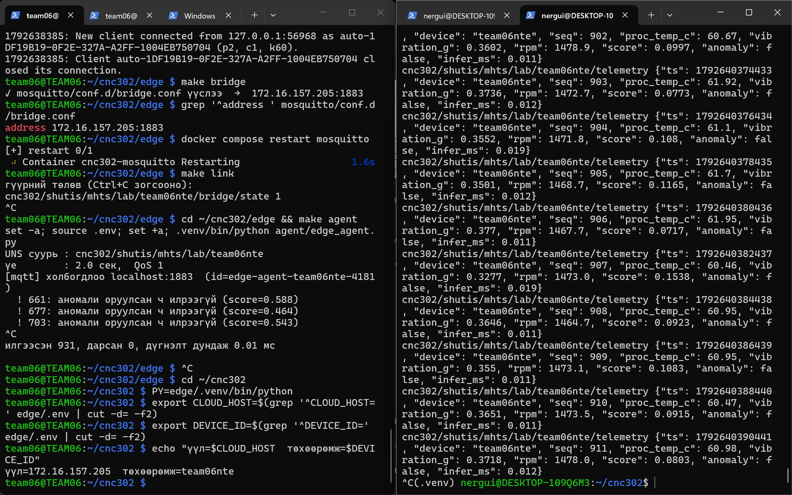

### 1.4. QoS 1 — 3 замын саатал

Pi дээр `edge/.venv/bin/python` ашиглан **300 × 0.05 секунд** тохиргоотой хэмжсэн:

```bash
cd ~/cnc302
PY=edge/.venv/bin/python
export CLOUD_HOST=$(grep '^CLOUD_HOST=' edge/.env | cut -d= -f2)
export DEVICE_ID=$(grep '^DEVICE_ID=' edge/.env | cut -d= -f2)

# Loopback
$PY tools/qos_latency.py --host localhost --port 1883 \
  --path loopback --qos 1 --count 300 --interval 0.05 \
  --csv lab01/out/04-latency-loopback.csv

# LAN (EMQX руу шууд)
$PY tools/qos_latency.py --host "$CLOUD_HOST" --port 1883 \
  --path lan --qos 1 --count 300 --interval 0.05 \
  --csv lab01/out/04-latency-lan.csv

# Bridge (Pi Mosquitto -> EMQX)
$PY tools/qos_latency.py --host localhost --port 1883 \
  --sub-host "$CLOUD_HOST" --sub-port 1883 \
  --topic "cnc302/shutis/mhts/lab/$DEVICE_ID/bench" \
  --path bridge --qos 1 --count 300 --interval 0.05 \
  --csv lab01/out/04-latency-bridge.csv
```

**Зураг 4–6.** Гурван замын бодит терминалын хэмжилтийн үр дүн.

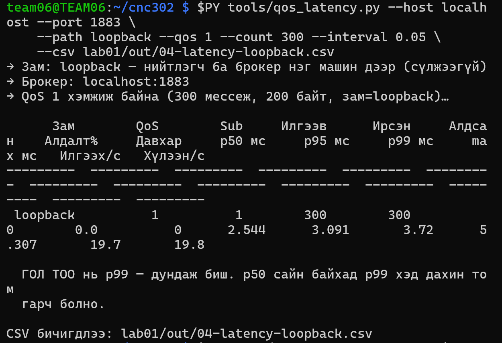

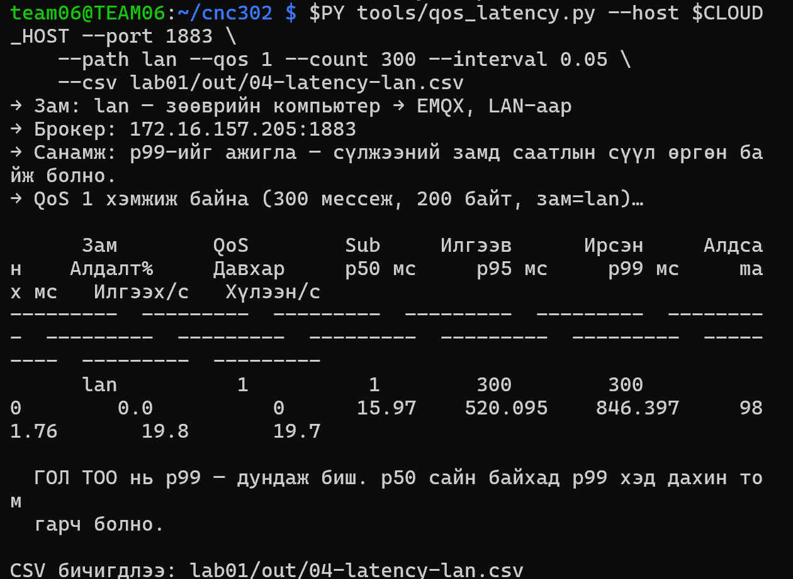

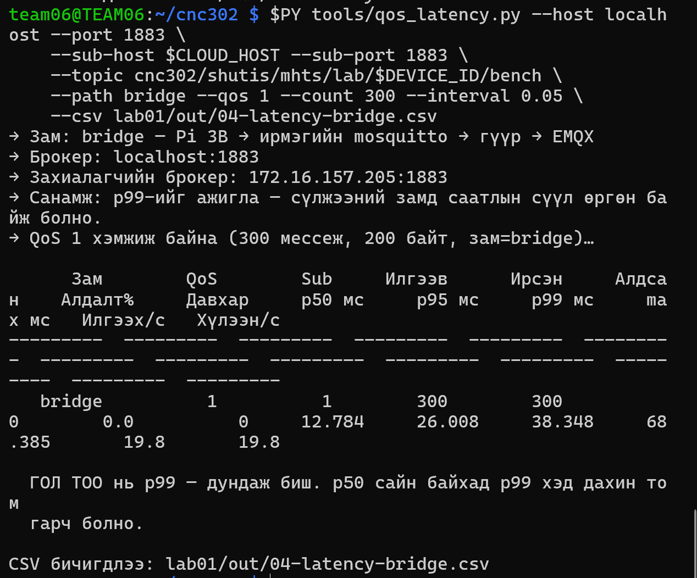

### 1.5. Виртуал флот болон Pi нөөцийн мониторинг

Ubuntu-ээс Pi-ийн **172.16.158.166:1883** MQTT broker руу 50, 100, 200 виртуал төхөөрөмжөөр тус тус туршсан. **Төхөөрөмжийн тоо тогтмол**; `--interval 1.0` нь төхөөрөмж бүрийн мессежийн интервал.

```bash
# Ubuntu WSL
cd ~/cnc302
source .venv/bin/activate
python tools/sim_device.py --host 172.16.158.166 --port 1883 \
  --target edge --devices 50 --interval 1.0
# Үүний дараа --devices 100, дараа нь --devices 200 болгож давтсан.
```

Pi дээр флот ажиллаж байх хугацаанд `vmstat`, `vcgencmd`, `MemAvailable` үзүүлэлтүүдийг давталтаар хянаж, нөөцийн хэмжилтийг файлд хадгалсан.

```bash
cd ~/cnc302
OUTDIR=lab01/out bash tools/measure_stack.sh --role edge \
  --watch 120 5 | tee lab01/out/05-load-050.txt
# 100/200 түвшинд 05-load-100.txt болон 05-load-200.txt нэрээр давтсан.
```

**Зураг 7.** Суурь мониторинг (флотгүй): `MemAvailable` ~535–540 MiB, `si=0 so=0`, `throttled=0x0`.

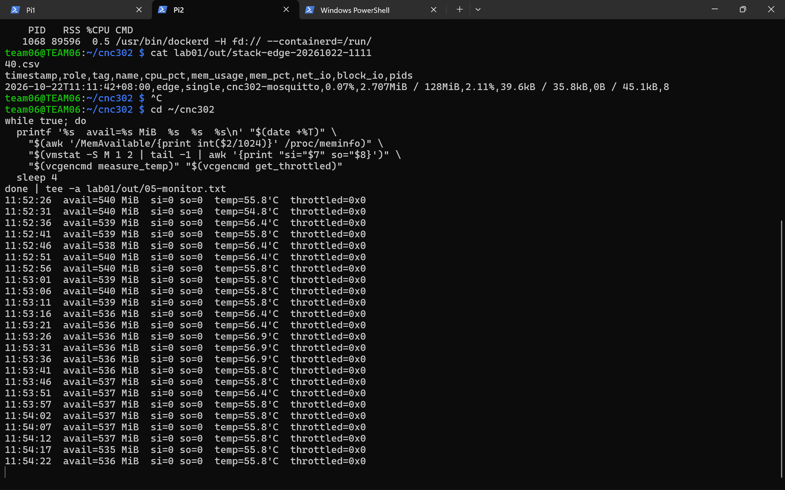

**Зураг 8.** 50 виртуал төхөөрөмж, тасалдал болон алдаа 0.

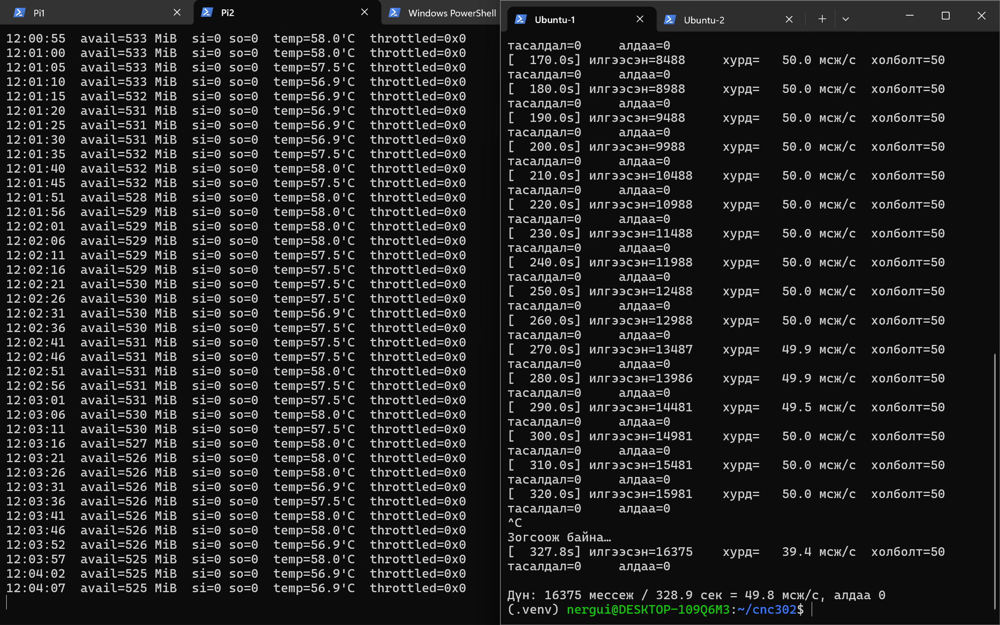

**Зураг 9.** 100 виртуал төхөөрөмж, тасалдал болон алдаа 0.

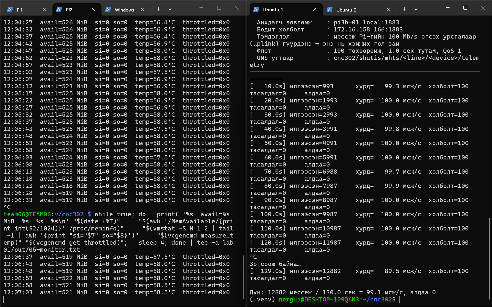

**Зураг 10.** 200 виртуал төхөөрөмж, алдаа 0; Pi-ийн ойролцоо хугацааны `measure_stack.sh` snapshot.

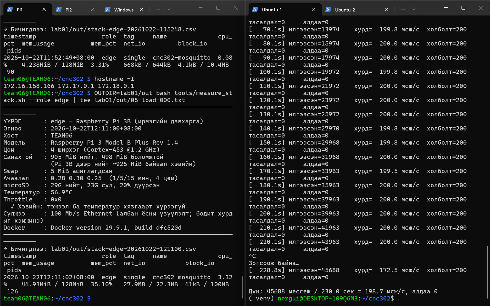

### 1.6. Cloud RAM болон ThingsBoard

```bash
# Ubuntu
cd ~/cnc302/stack
docker stats --no-stream --format 'table {{.Name}}\t{{.MemUsage}}'

docker compose -f docker-compose.yml -f docker-compose.tb.yml \
  --profile core --profile tb up -d
sleep 180
docker stats --no-stream cnc302-thingsboard
# Туршилтын дараа зогсооно:
docker compose -f docker-compose.yml -f docker-compose.tb.yml \
  --profile tb stop thingsboard
```

**Зураг 11–12.** Cloud-ийн 4 үндсэн контейнерийн RAM хэрэглээ, ThingsBoard 3.9.1-ийн бодит хэмжилт.

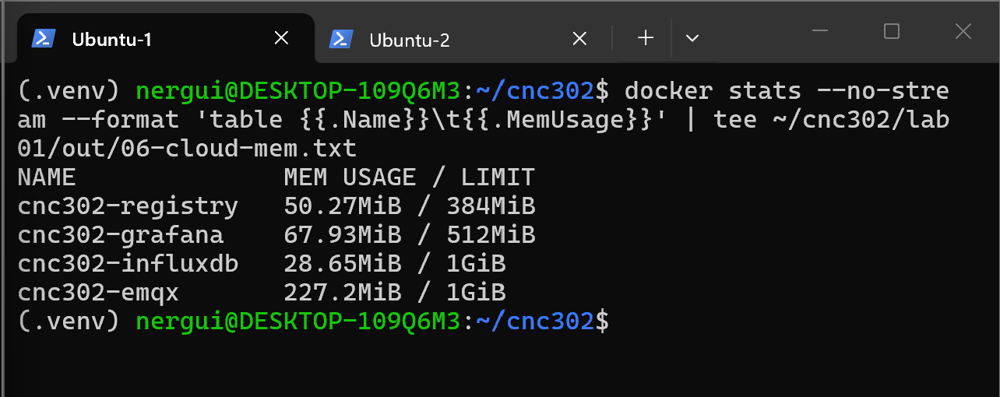

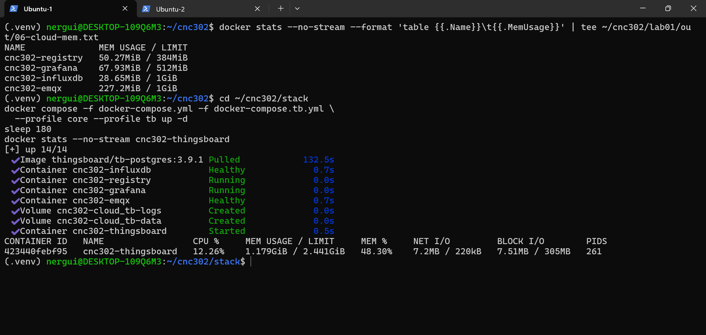

### 1.7. InfluxDB3 / Grafana

Ubuntu дээр лабораторийн түр MQTT → InfluxDB3 шугам ажиллуулж, `health` ба `bridge` measurement-д өгөгдөл бичиж байгааг терминал дээр харсан. Grafana-ийн хоёр панелийн **бодит үр дүн** харагдсан: `Pi MemAvailable` шугаман график болон `Гүүрний төлөв = 1`.

`DEVICE_ID=team06nte` ашигласан **SQL**:

```sql
-- Pi CPU температур (Time series)
SELECT time, cpu_temp_c
FROM health
WHERE device = 'team06nte' AND $__timeFilter(time)
ORDER BY time;

-- Pi MemAvailable (Time series)
SELECT time, mem_available_mb
FROM health
WHERE device = 'team06nte' AND $__timeFilter(time)
ORDER BY time;

-- Гүүрний төлөв (Stat)
SELECT time, state
FROM bridge
WHERE device = 'team06nte'
ORDER BY time DESC LIMIT 1;
```

> **Анхаар:** Гүүрний `1` нь SQL хүснэгт дэх **хамгийн сүүлийн хадгалагдсан төлөв**; тасралтгүй бодит цагийн холболтыг дангаар батлахгүй. CPU температурын **Grafana панелийн screenshot ороогүй** тул нөгөө хоёр панель шиг бүрэн баталгаажуулаагүй.

**Зураг 13–15.** Түр InfluxDB write шугам; Grafana MemAvailable; Grafana bridge `1`.

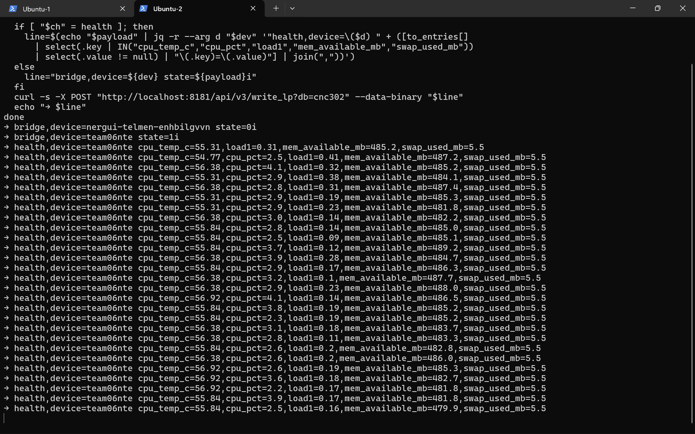

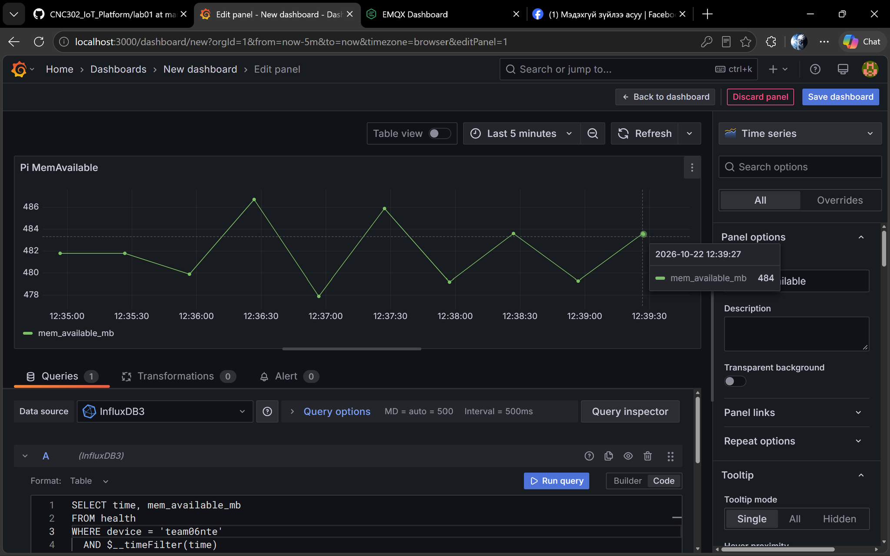

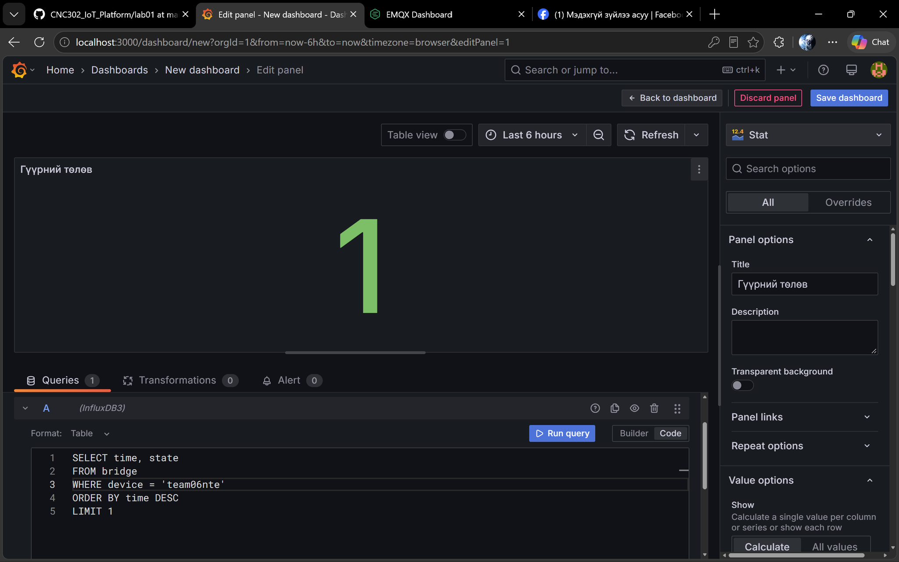

---

## 2. Хэмжилтийн үр дүн

### 2.1. Хүснэгт 1.4 — Гурван замын саатал (QoS 1, зам бүр 300 мессеж)

| Зам | Илгээсэн | Ирсэн | p50 (мс) | p95 (мс) | p99 (мс) | max (мс) | Алдагдал |
|---|---:|---:|---:|---:|---:|---:|---:|
| Loopback | 300 | 300 | 2.544 | 3.091 | 3.720 | 5.307 | 0.0% |
| LAN (Pi → EMQX) | 300 | 300 | 15.970 | 520.095 | 846.397 | 981.760 | 0.0% |
| MQTT Bridge | 300 | 300 | 12.784 | 26.008 | 38.348 | 68.385 | 0.0% |

Нийт **900 / 900** мессеж амжилттай хүлээн авсан. Тухайн туршилтаар LAN замын p99 саатал bridge замаас **22.07 дахин** өндөр байсан (`846.397 / 38.348`), гэхдээ энэ нь bridge заавал хурдан гэсэн ерөнхий хууль биш.

### 2.2. Хүснэгт — Виртуал төхөөрөмжийн флотын бодит үр дүн

| Үзүүлэлт | Суурь (0) | 50 төхөөрөмж | 100 төхөөрөмж | 200 төхөөрөмж |
|---|---:|---:|---:|---:|
| Холбогдсон төхөөрөмж | 0 | 50 | 100 | 200 |
| Туршилтын нийт хугацаа (сек) | — | 328.9 | 130.0 | 230.0 |
| Нийт илгээсэн мессеж | 0 | 16,375 | 12,882 | 45,688 |
| Дундаж илгээлтийн хурд (мессеж/сек) | 0 | **49.8** | **99.1** | **198.7** |
| Скриптийн алдаа / тасалдал | — | **0 / 0** | **0 / 0** | **0 / 0** |
| Pi MemAvailable (зурагт ажиглагдсан; MiB) | **538** (суурь snapshot) | **~525–533** | **~518–526** | **498** (хавсарсан snapshot) |
| Swap `si/so` (харуулсан хяналтын мөрүүд) | **0/0** | **0/0** | **0/0** | **Бүх хугацааны мөр харагдахгүй** |
| Pi температур (°C; харагдсан) | **55.8** | **~56.9–58.0** | **~56.4–58.5** | **56.9** (хавсарсан snapshot) |
| `throttled` (харагдсан) | `0x0` | `0x0` | `0x0` | `0x0` (snapshot) |

**Тайлбар:** 50 ба 100 төхөөрөмжийн `MemAvailable` нь зурагт харагдах 5 секунд тутмын мониторын ойролцоо муж; **200 төхөөрөмжийн 498 MiB нь ганц `measure_stack.sh` snapshot** юм. Эдгээр нь `05-load-*.txt` файлын бүх 120 секундын нягтлан бодсон min/max/average **биш**. Түүнчлэн флотын `алдаа=0` нь скриптийн бүртгэл; бүх мессеж захиалагчид хүрснийг тусдаа захиалагчийн тооллогоор хэмжээгүй.

#### 200 төхөөрөмжийн үед Mosquitto контейнерийн snapshot

| Үзүүлэлт | Суурь snapshot | 200 төхөөрөмжтэй холбогдсон snapshot |
|---|---:|---:|
| Container memory usage | **4.238 MiB / 128 MiB** | **44.93 MiB / 128 MiB** |
| Memory usage / limit | **3.31%** | **35.10%** |
| Container CPU | **0.08%** | **3.32%** |
| PIDs | **90** | **126** |

Дээрх агшны хэмжилтэд контейнерийн хэрэглээ өссөн боловч 128 MiB хязгаараас хэтрээгүй. **200 төхөөрөмж Pi-ийн санах ойн эцсийн хязгаарт хүрснийг батлах боломжгүй.**

### 2.3. Cloud үндсэн контейнерүүдийн RAM

| Контейнер | RAM хэрэглээ |
|---|---:|
| `cnc302-registry` | 50.27 MiB |
| `cnc302-grafana` | 67.93 MiB |
| `cnc302-influxdb` | 28.65 MiB |
| `cnc302-emqx` | 227.20 MiB |
| **Нийт (4 контейнерийн нийлбэр)** | **374.05 MiB** |

Энэ нь **сонгосон дөрвөн контейнерийн snapshot нийлбэр**, бүх Docker Engine болон үйлдлийн системийн RAM хэрэглээ биш.

### 2.4. ThingsBoard 3.9.1 RAM хэмжилт

| Үзүүлэлт | Хэмжилт |
|---|---:|
| RAM хэрэглээ | **1.179 GiB ≈ 1207.3 MiB** |
| RAM limit | **2.441 GiB** |
| CPU | **12.26%** |
| RAM / limit | **48.30%** |
| PIDs | **261** |
| Raspberry Pi-ийн хэмжигдсэн нийт RAM | **905 MiB** |
| ThingsBoard / Pi total RAM | **1207.3 / 905 ≈ 1.33 дахин** |

**Үр дүн:** Зөвхөн ThingsBoard контейнерийн хэмжигдсэн RAM хэрэглээ л Raspberry Pi-ийн нийт RAM-аас **ойролцоогоор 1.33 дахин** их байгаа тул бүрэн IoT cloud платформыг Pi дээр ажиллуулах нь эрсдэлтэй; хөнгөн edge үйлчилгээ ба cloud үйлчилгээг салгах нь үндэслэлтэй.

### 2.5. Grafana бодит үр дүн

| Панел | Хэмжилт / төлөв | Баталгаажуулалт |
|---|---|---|
| Pi MemAvailable | Шугаман график, **~478–487 MiB**; tooltip-ийн нэг цэг **484 MiB** (2026-10-22 12:39:27) | Зураг 14 |
| Гүүрний төлөв | **1** | Зураг 15 |
| Pi CPU температур | InfluxDB3 write мөрүүдэд **55–57 °C** орчим мэдээлэл байгаа | Тусдаа Grafana панелийн screenshot харагдаагүй |

---

## 3. Дүгнэлт

1. Raspberry Pi 3 Model B Plus Rev 1.4 дээр Mosquitto broker ажиллаж, EMQX-тэй MQTT bridge холболт тогтсон (`state 1`). Edge agent-ийн **931 илгээлт, 0 алдсан** гэсэн дүн, Ubuntu талд ирсэн `team06nte/telemetry` урсгал нь edge → cloud зам ажилласны нотолгоо болсон.
2. QoS 1 саатлын гурван замд тус бүр 300 буюу нийт **900 мессежийг 0% алдагдалтай** хэмжсэн. **p99**: loopback **3.720 мс**, LAN **846.397 мс**, bridge **38.348 мс**. LAN-ийн огцом саатлын шалтгааныг ганц удаагийн туршилтаар тодорхойлох боломжгүй.
3. 50, 100, 200 төхөөрөмжийн флотууд тус бүр ойролцоогоор **49.8 / 99.1 / 198.7 мессеж/секунд** хурдтай ажиллаж, скриптээр бүртгэгдсэн алдаа/тасалдал **0** байсан. 200 төхөөрөмжийн үеийн Mosquitto RAM snapshot **44.93 MiB** байсан; RAM-ийн дээд хязгаарт хүрсэн гэж дүгнэх үндэслэл одоогоор алга.
4. Харагдсан Pi мониторын мөрүүдэд `si=0`, `so=0`, `throttled=0x0` байсан бөгөөд температур 70 °C-аас бага байв. Иймээс ажиглагдсан хугацаанд swap эрчимтэй хөдөлсөн эсвэл температурын throttling болсон шинжгүй.
5. ThingsBoard-ийн RAM хэрэглээ **1.179 GiB** буюу Pi-ийн нийт RAM-аас **1.33 дахин их**; cloud хэрэгслүүдийг laptop/cloud, харин хөнгөн broker болон AI agent-ийг edge талд байрлуулах шийдэл тохиромжтой.
6. InfluxDB3-д `health`, `bridge` өгөгдөл бичигдэж, Grafana дээр **MemAvailable график** болон **Bridge = 1** дүрслэгдсэн. Гэхдээ CPU температурын панелийн эцсийн screenshot болон бүх мэдээллийн тасралтгүй хадгалалт тус тусдаа нэмэлт шалгалт шаардлагатай.

---

## 4. Хяналтын асуултын хариулт

> Албан ёсны хяналтын асуултын эх текст хавсаргасан зурагт харагдахгүй байна. Доорх нь **туршилтын агуулгад тохирсон жишиг асуулт ба хариулт**, албан ёсны асуултыг орлуулахдаа нягтална.

1. **MQTT bridge ашиглахын зорилго юу вэ?** — Edge Mosquitto ба cloud EMQX broker-ийн хооронд MQTT topic-уудыг дамжуулж, edge өгөгдлийг cloud орчинд хүргэдэг. Уг туршилтын `bridge/state 1` нь холболт тогтсоныг харуулсан.
2. **p99 яагаад чухал вэ?** — p99 нь хэмжилтийн 99 хувь түүнээс бага буюу тэнцүү сааталтай байгааг илэрхийлж, ховор өндөр саатлыг илрүүлдэг. LAN-ийн p50 **15.970 мс** байсан ч p99 **846.397 мс** хүрсэн.
3. **Edge ба cloud орчныг яагаад салгах хэрэгтэй вэ?** — Pi-д 905 MiB RAM харагдсан байхад ThingsBoard контейнер 1207.3 MiB хэрэглэсэн. Нөөц их шаардах өгөгдөл хадгалалт, dashboard платформыг cloud талд, хөнгөн брокер/agent-ийг edge талд ажиллуулах нь хэмжилтээр дэмжигдсэн.

---

## 5. Тулгарсан асуудал ба шийдэл

| Асуудал | Шалтгаан | Арга хэмжээ / бодит үр дүн | Хугацаа |
|---|---|---|---|
| `mosquitto ✗` | Broker эхний шалгалтаар ажиллаагүй | `make up`-аар асааж, `make check`-д `mosquitto OK` болсон | Минутын бүртгэлгүй |
| MQTT bridge `state 0` | Laptop-ийн Wi-Fi IP өөрчлөгдөж, Mosquitto хуучин cloud IP рүү холбогдож байсан | `CLOUD_HOST` шинэчилж `make bridge`, Mosquitto restart; дараа нь `bridge/state 1` | Минутын бүртгэлгүй |
| SCP `Permission denied (publickey)` | `cnc302` гэж Pi-ийн SSH username-ийг буруу бичсэн | `team06@172.16.158.166` болгох командыг зассан; файл амжилттай хуулсны нотолгоо зурагт харагдахгүй | Минутын бүртгэлгүй |
| InfluxDB3 `cnc302` database олдохгүй | Эхний шалгалтад зөвхөн `_internal` байсан | Дараагийн шалгалтаар `cnc302` database үүссэн; InfluxDB-д `health`, `bridge` бичилт харагдсан | Минутын бүртгэлгүй |
| Grafana `No data` | Панел query / дата хадгалалт бүрэн бэлтгэгдээгүй | `device='team06nte'` SQL ашиглаж `MemAvailable` график, `Bridge=1` харуулсан | Минутын бүртгэлгүй |

---

## 6. Ашигласан эх сурвалж

1. CNC302 IoT Platform, лабораторийн эх код ба заавар: https://github.com/BatdalaiS/CNC302_IoT_Platform
2. Docker documentation: https://docs.docker.com/
3. Eclipse Mosquitto documentation: https://mosquitto.org/documentation/
4. EMQX documentation: https://docs.emqx.com/
5. InfluxDB 3 Core documentation: https://docs.influxdata.com/influxdb3/core/
6. Grafana documentation: https://grafana.com/docs/
7. ChatGPT (OpenAI): 2026-10-22–2026-11-04, командын тайлбар, алдааны оношилгоо, хэмжилтийн тооцоолол, тайлан боловсруулахад туслав. Тоон мэдээллийг хэрэглэгчийн 2026-10-22-ны терминал, Grafana screenshot-уудтай тулгав.

---

## 7. Хэмжилтийн файлууд ба нотлох зургууд

Туршилтад ашиглагдсан эсвэл гаралтад бичигдсэн **файлын нэрс** (эдгээр файл бүгд энэ ZIP дотор байхгүй, зөвхөн нотлох зургууд орсон):

```text
lab01/out/
├── 01-edge-baseline.txt           # байгаа эсэхийг шалгах
├── 02-cloud-snapshot.txt
├── 03-edge-running.txt            # байгаа эсэхийг шалгах
├── 04-latency-loopback.csv
├── 04-latency-lan.csv
├── 04-latency-bridge.csv
├── 05-load-000.txt
├── 05-load-050.txt                 # байгаа эсэхийг шалгах
├── 05-load-100.txt                 # байгаа эсэхийг шалгах
├── 05-load-200.txt                 # байгаа эсэхийг шалгах
├── 05-monitor.txt
├── 06-cloud-mem.txt
├── stack-edge-20261022-115248.csv
├── stack-edge-20261022-121100.csv
├── stack-cloud-20261022-104415.csv
├── startup-cloud-20261022-104141.csv
└── sysinfo-cloud-20261022-104415.txt
```

Нотлох зургууд `images/` хавтаст 15 файлтай бөгөөд тус бүрийг тайлангийн холбогдох хэсэгт Markdown зургийн холбоосоор оруулсан.

**Git репозиторт оруулахад:** тайланг `lab01/REPORT.md`, хавсаргасан зургуудыг `lab01/images/` дотор байрлуулна. Гэхдээ сургалтын зааварт `lab01/out/`-ийн хэмжилтийн файлуудыг Git-д оруулахгүй гэсэн тул хэмжилтийн файлуудыг Git-д хүчээр нэмэхгүй.

### Баталгаажуулаагүй үлдсэн зүйлс

- Git commit hash болон tag бодитоор үүссэн эсэх;
- Хост laptop-ийн процессорын **загвар**, Windows физик RAM-ийн нарийн хэмжээ;
- microSD картын хурдны ангилал, Pi сүлжээний бодит bandwidth;
- VS Code server зогсоосон эсэх;
- 50/100/200 түвшний 120 секундын monitor файлуудын бүх мөрөөр тооцсон min/mean/max;
- Grafana CPU температурын тусдаа панелийн screenshot;
- Лаб 1-ийн багшийн **албан ёсны** хяналтын асуултын бичвэр.
