# Лаб 02 — Тайлан

**Сэдэв:** Төхөөрөмжийн бүрэн амьдралын мөчлөг, bulk/JIT бүртгэл, X.509 ба mTLS, OTA, canary болон хүчингүй болгох

**Баг:** TEAM-06  
**Огноо:** 2026-11-05  
**Хичээл:** CNC302 — IoT Platform

**Гишүүд ба хувь нэмэр:**

| Гишүүн | Хийсэн ажил (баталгаажуулах санал болгосон хуваарилалт) |
|---|---|
| B231950001 М.Нэргүй | Raspberry Pi, mTLS клиент, LAN OTA ба rollback туршилт |
| B231950003 А.Тэлмэн | Ubuntu WSL cloud, EMQX/registry, сертификат ба тайлангийн нэгтгэл |
| B231950027 Г.Энхбилгүүн | Bulk/JIT, виртуал флот, canary, revocation ба хэмжилтийн нэгтгэл |

> Гишүүдийн нэр, кодыг Лаб 1-ийн тайлангаас авсан. Лаб 2-ын бодит ажлын хуваарилалт зурагт ялгарахгүй тул дээрх санал болгосон хуваарилалтыг баг баталгаажуулна.

**Git commit:** Туршилтад ашигласан commit SHA ирээгүй.  
**Tag:** `lab02-done` — шаардлагатай tag; үүсгэж push хийсэн баримт ирээгүй.

> Тайланг ирүүлсэн терминалын зургууд болон багшийн `lab02/README.md` зааварт үндэслэн боловсруулав. «Баримт ирээгүй» гэдэг нь ажил хийгдээгүйг батлахгүй, харин энэ тайланд баталгаажуулах өгөгдөл байхгүйг илэрхийлнэ. Нууц үгийн утгуудыг оруулаагүй. Доорх командын гаралтууд нь зургаас буулгасан холбогдох хэсгүүд бөгөөд бүтэн лог биш.

---

## 0. Хэмжилтийн орчин

| Үзүүлэлт | Raspberry Pi 3B | Зөөврийн компьютер |
|---|---|---|
| Загвар / процессор | Лаб 1-ийн тайланд Raspberry Pi 3 Model B Plus Rev 1.4 гэж бүртгэсэн; Лаб 2-т загвар/CPU-г дахин хэвлэсэн гаралт ирээгүй | `DESKTOP-10906M3`; процессорын загвар ирээгүй |
| RAM — нийт / боломжтой | `top`: нийт 905.0 MiB; free 66.8 MiB; used 400.1 MiB. Available-ийн мөр тасарсан | Нийт/available RAM-ийн системийн гаралт ирээгүй; ThingsBoard самбар 8 GB гэж харуулсан боловч энэ нь Windows-ийн физик RAM-ийг батлахгүй |
| OS, цөмийн хувилбар | SSH дэлгэц дээр Debian GNU/Linux; хувилбар болон kernel ирээгүй | Windows дээр Ubuntu/WSL; Ubuntu ба kernel хувилбар ирээгүй |
| Сүлжээ | SSH хаяг `172.16.158.166`; Pi талын кабель/Wi-Fi, link speed ирээгүй | Windows Wi-Fi IPv4 `172.16.153.202`; WSL vEthernet `172.30.80.1`; хурд ирээгүй |
| Хадгалалт | microSD багтаамж, ангилал ирээгүй | Дискний төрөл/багтаамжийн баталгаатай системийн гаралт ирээгүй |
| Docker хувилбар | Гаралт ирээгүй | Гаралт ирээгүй; Docker Compose ашигласан |
| Нэмэлт программ | Mosquitto CLI, OpenSSL, `edge/.venv/bin/python` | Python 3.14 venv; EMQX 5.8.6; ThingsBoard 3.9.1 |

**Хэмжилтийн өмнөх шалгалт (Pi):**

| Шалгалт | Утга | Хэвийн үү |
|---|---|---|
| `vcgencmd get_throttled` | Гаралт ирээгүй | `0x0` шаардлагатай; баталгаажаагүй |
| `vcgencmd measure_temp` | Гаралт ирээгүй | <70 °C эсэх баталгаажаагүй |
| `free -m` → available | Гаралт ирээгүй | >400 MiB эсэх баталгаажаагүй; free ба available нь ялгаатай |
| `timedatectl` synchronized | Гаралт ирээгүй | `yes` эсэх баталгаажаагүй |
| VS Code сервер таслагдсан уу | Гаралт ирээгүй | Баталгаажаагүй |

`get_throttled` шалгалт ирээгүй тул хэмжилтүүдийг дулаан/тэжээлийн нөлөөгүй гэж батлах боломжгүй. Доорх тоонууд нь ажигласан үр дүн; зааврын хэмжилтийн хүчинтэй байдлыг бүрэн баталгаажуулаагүй.

---

## 1. Гүйцэтгэсэн ажил

### 1.1 Орчны бэлтгэл ба үйлчилгээний шалгалт

```bash
cd ~/cnc302
git pull
pip install -r tools/requirements.txt
python -c "import httpx, paho.mqtt; print('OK')"
cd ~/cnc302/stack && make up && make health
curl -s localhost:8090/health | jq
```

Холбогдох гаралт:

```text
Already up to date.
OK
EMQX      200
InfluxDB  200
Grafana   200
Registry  200
{"ok": true, "devices": 0, "mqtt": true}
```

Pi дээр `cd ~/cnc302/edge && make link` ажиллуулахад:

```text
cnc302/shutis/mhts/lab/team06nte/bridge/state 1
```

Cloud хаяг `172.16.153.202` байв. Эхэндээ Pi дээр `DEV=team06nte`, Ubuntu дээр `DEV=pi3b-team06` байсан. LAN OTA хийх үед Ubuntu-ийн утгыг `export DEV=team06nte` болгож ижилсүүлсэн.

**Зураг 1.** Cloud health ба bridge.

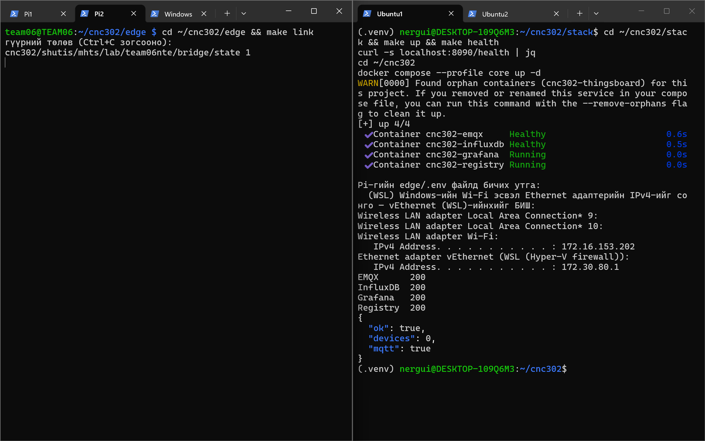

**Зураг 2.** Bulk бүртгэлийн хэмжилт.

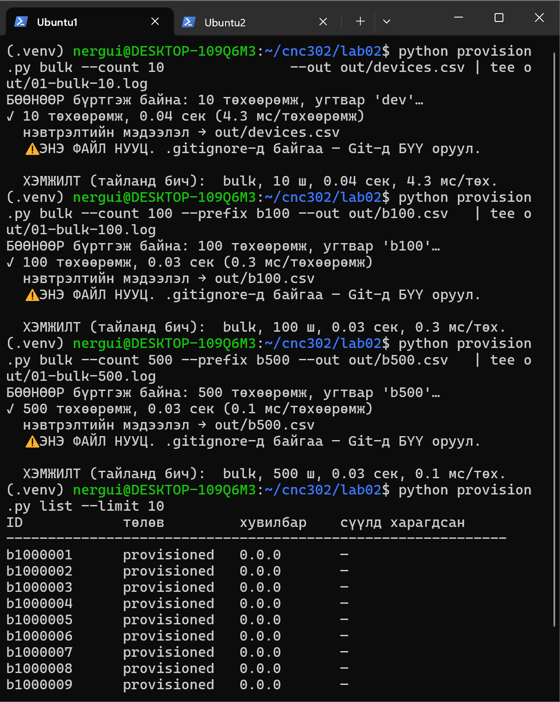

### 1.2 EMQX API ба бүртгэл

```bash
cd ~/cnc302/stack
export EMQX_API_KEY=$(grep '^EMQX_API_KEY=' .env | cut -d= -f2)
export EMQX_API_SECRET=$(grep '^EMQX_API_SECRET=' .env | cut -d= -f2)
curl -s -u "$EMQX_API_KEY:$EMQX_API_SECRET" \
  localhost:18083/api/v5/nodes | jq '.[0].version'
```

```text
"5.8.6"
```

Built-in database authenticator үүсгэх хүсэлтийн гаралт:

```text
"password_based:built_in_database"
false
```

```bash
cd ~/cnc302/lab02
python provision.py bulk --count 10 --out out/devices.csv | tee out/01-bulk-10.log
python provision.py bulk --count 100 --prefix b100 --out out/b100.csv | tee out/01-bulk-100.log
python provision.py bulk --count 500 --prefix b500 --out out/b500.csv | tee out/01-bulk-500.log
python provision.py list --limit 10
git check-ignore -v out/devices.csv
```

```text
10 төхөөрөмж, 0.04 сек (4.3 мс/төхөөрөмж)
100 төхөөрөмж, 0.03 сек (0.3 мс/төхөөрөмж)
500 төхөөрөмж, 0.03 сек (0.1 мс/төхөөрөмж)
.gitignore:53:lab02/out/*  out/devices.csv
```

CSV-ийн `emqx` баганад `skipped (EMQX_API_KEY тохируулаагүй)` гарсан. Терминалаас EMQX API-д нэвтэрч чадсан нь registry контейнерт түлхүүр зөв дамжсаныг дангаараа батлахгүй.

```bash
python provision.py jit --device-id "$DEV" | tee out/02-jit.log
python provision.py jit --device-id "$DEV" | tee -a out/02-jit.log
python provision.py jit --device-id team06 | tee -a out/02-jit.log
python provision.py list --limit 1000 | grep 'team06'
```

```text
pi3b-team06  нууц үг=[НУУЦЛАВ]  (29.1 мс)
pi3b-team06  нууц үг=[НУУЦЛАВ]  (21.8 мс)
тэмдэглэл: аль хэдийн бүртгэлтэй
team06      нууц үг=[НУУЦЛАВ]  (26.9 мс)
pi3b-team06  active  0.0.0
team06      active  0.0.0
```

Давтан JIT дуудлага ижил нууц үг буцаасан. Таних тэмдгийг баталгаажуулахгүй хүсэлт бүртгэл болон нэвтрэлтийн мэдээлэлд хүрэх боломжтойг ажиглав.

### 1.3 X.509 ба mTLS

```bash
CLOUD_HOST=172.16.153.202 bash make_certs.sh init
bash make_certs.sh device pi3b-team06
bash make_certs.sh device dev0001
openssl verify -CAfile certs/ca.crt certs/server.crt certs/pi3b-team06.crt
openssl x509 -in certs/server.crt -noout -ext subjectAltName
```

```text
certs/server.crt: OK
certs/pi3b-team06.crt: OK
DNS:cnc302-cloud, DNS:localhost, DNS:emqx,
IP Address:127.0.0.1, IP Address:172.16.153.202
```

Төхөөрөмжийн сертификатын CN нь `pi3b-team06`, EKU нь `TLS Web Client Authentication`; хүчинтэй хугацаа 2026-11-05 02:31:00 GMT–2027-11-05 02:31:00 GMT. CA ба төхөөрөмжийн сертификат, түлхүүрийг SCP-ээр Pi рүү хуулсан.

EMQX-ийн шалгалт:

```text
ssl:default
listen_on :8883
{"verify":"verify_peer","fail_if_no_peer_cert":true}
```

```bash
time mosquitto_pub -h "$CLOUD_HOST" -p 8883 -d \
  --cafile certs/ca.crt --cert certs/pi3b-team06.crt \
  --key certs/pi3b-team06.key \
  -t "cnc302/shutis/mhts/lab/$DEV/telemetry" -m '{"tls":true}'
time mosquitto_pub -h "$CLOUD_HOST" -p 1883 -d \
  -t "cnc302/shutis/mhts/lab/$DEV/telemetry" -m '{"tls":false}'
```

Хоёр холболтод `CONNACK (0)` гарсан; `real` нь 0.231 ба 0.068 сек. Сертификатгүй 8883 холболтод `tlsv13 alert certificate required`, өөрөө зурсан сертификаттай холболтод `The connection was lost` гарсан.

```bash
$PY ../tools/qos_latency.py --host "$CLOUD_HOST" --port 8883 \
  --path lan --count 200 --tls --ca certs/ca.crt \
  --cert certs/pi3b-team06.crt --key certs/pi3b-team06.key \
  --csv out/03-lat-8883.csv | tee out/03-lat-8883.log
$PY ../tools/qos_latency.py --host "$CLOUD_HOST" --port 1883 \
  --path lan --count 200 --csv out/03-lat-1883.csv | tee out/03-lat-1883.log
```

QoS 1, 200 байтын 200 мессежээр хэмжсэн. Команд Pi терминалаас ажилласан тул скриптийн тайлбар дахь «зөөврийн компьютер → EMQX» гэсэн тогтмол бичвэрийг бодит эх үүсвэр гэж үзээгүй.

**Зураг 3.** Сертификатын шалгалт.

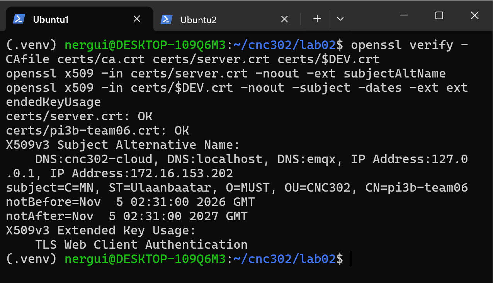

**Зураг 4.** mTLS listener.

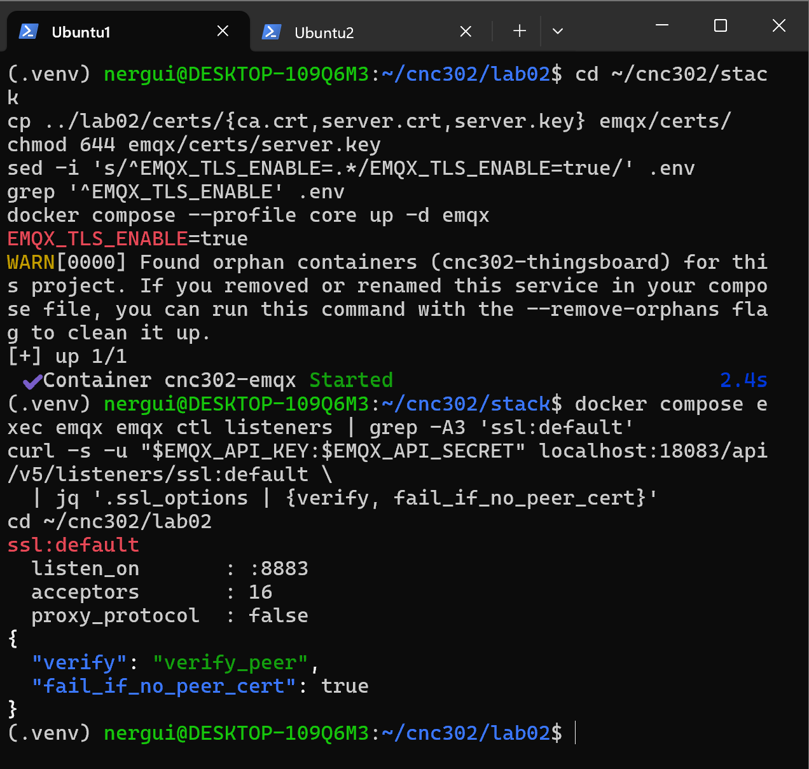

**Зураг 5.** TLS ба энгийн холболт.

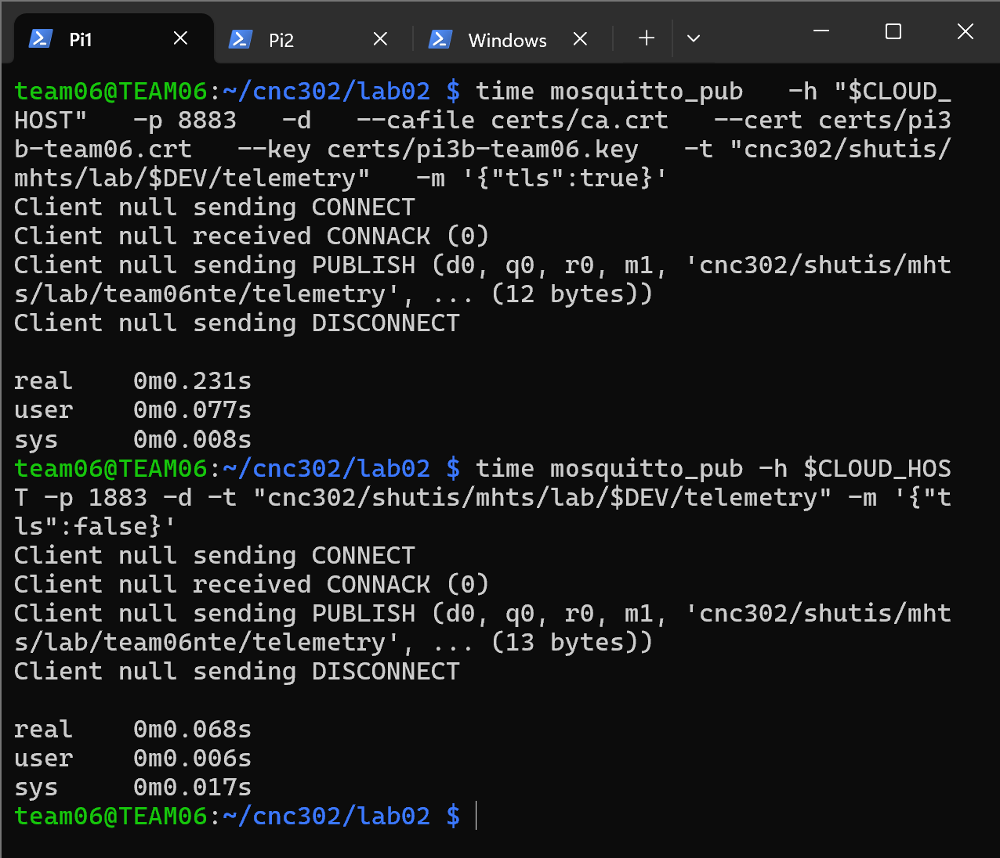

**Зураг 6.** Сертификатгүй клиент.

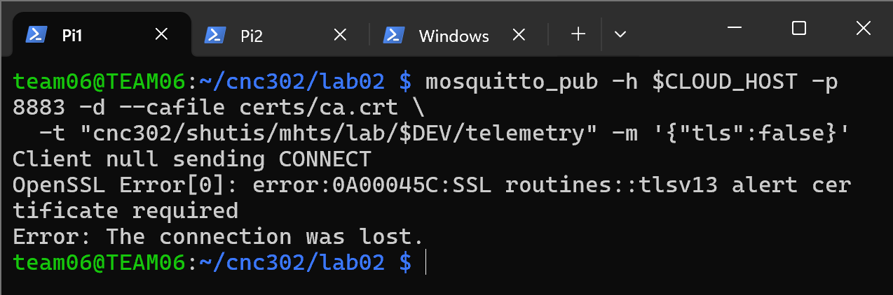

**Зураг 7.** mTLS QoS 1.

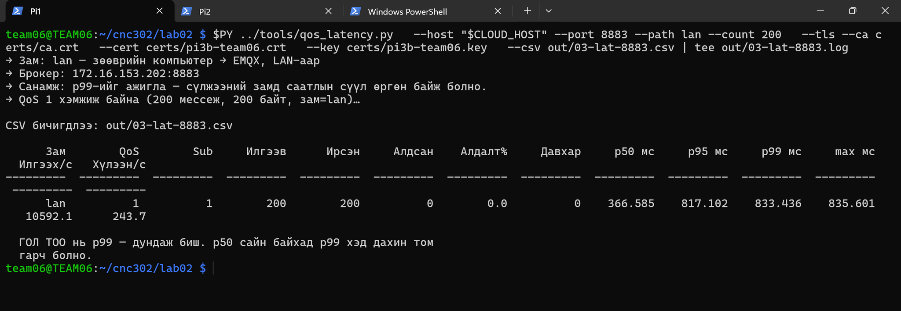

**Зураг 8.** TLS-гүй QoS 1.

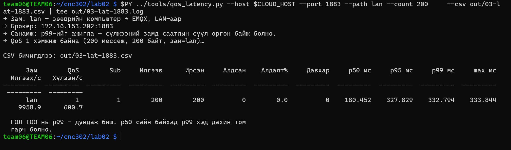

**Зураг 9.** Pi OpenSSL.

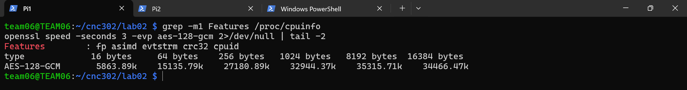

**Зураг 10.** Компьютер OpenSSL.

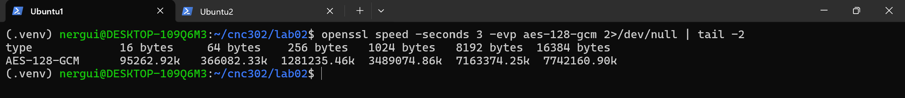

### 1.4 OTA — хэвийн шинэчлэлт

Компьютерт 512 KiB туршилтын binary үүсгэж firmware API-д байршуулсан. Энэ нь бодит төхөөрөмжийн үйлдлийн системийг flash хийсэн туршилт биш; агент binary файл болон version файлыг удирдсан лабораторийн дуурайлт юм.

```bash
head -c 524288 /dev/urandom > /tmp/fw-1.2.0.bin
FW=$(curl -s -X POST 'localhost:8090/firmware?version=1.2.0' \
  -F 'file=@/tmp/fw-1.2.0.bin' | jq -r .fw_id)
```

Loopback агент:

```bash
python -u ota_agent.py --host localhost --device "$DEV" \
  --out /tmp/fw-loop --once | tee out/04-ota-loop.log
```

Pi-ийн LAN агент:

```bash
$PY -u ota_agent.py --host "$CLOUD_HOST" --device "$DEV" \
  --out out/fw --once | tee out/04-ota-lan.log
```

Агент санал хүлээж эхэлсний дараа Ubuntu дээр тохирох `DEV` утгаар rollout санал илгээсэн. Төлөвүүд:

```text
DOWNLOADING → DOWNLOADED → VERIFIED → UPDATING → UPDATED
512 KiB LAN: 524288 байт, 5.3 сек, 97 KiB/сек
128 KiB LAN: 131072 байт, 1.1 сек, 118 KiB/сек
2 MiB LAN: 2097152 байт, 21.8 сек, 94 KiB/сек
```

```bash
cat out/fw/version.txt
```

```text
1.2.2
```

**Зураг 11.** Loopback OTA.

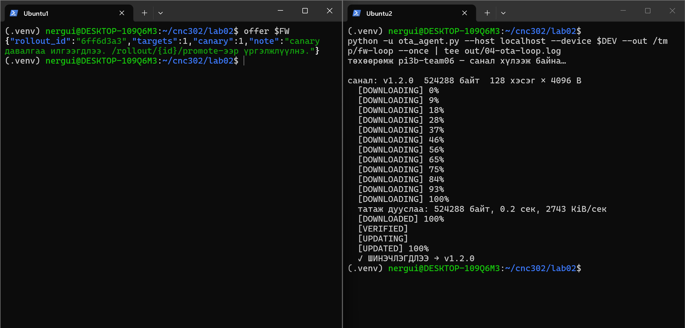

**Зураг 12.** LAN OTA ба DEV засвар.

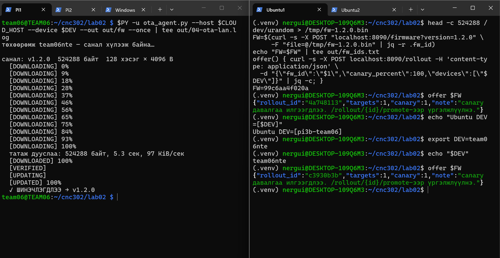

**Зураг 13.** 128 KiB OTA.

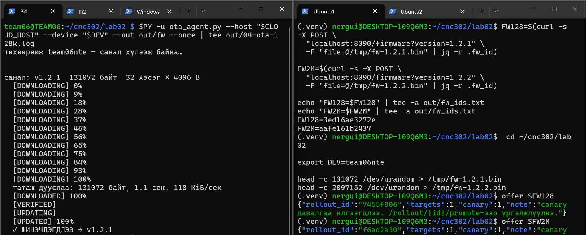

**Зураг 14.** 2 MiB OTA.

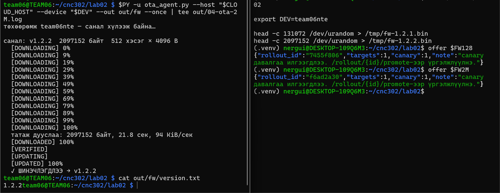

### 1.5 OTA алдаа дуурайлгах

`v1.3.0`, 128 KiB firmware-ээр туршсан.

```bash
$PY -u ota_agent.py --host "$CLOUD_HOST" --device "$DEV" \
  --out out/fw --once --fail-verify | tee out/05-fail-verify.log
cat out/fw/version.txt
```

```text
131072 байт, 1.1 сек, 117 KiB/сек
[DOWNLOADED] 100%
[FAILED]
ШАЛГАЛТ УНАЛАА — суулгахгүй. Хуучин хувилбар хэвээр.
1.2.2
```

```bash
$PY -u ota_agent.py --host "$CLOUD_HOST" --device "$DEV" \
  --out out/fw --once --fail-apply | tee out/05-fail-apply.log
sha256sum out/fw/current.bin out/fw/previous.bin
cat out/fw/version.txt
```

```text
131072 байт, 1.0 сек, 126 KiB/сек
[VERIFIED]
[UPDATING]
[ROLLED_BACK]
БУЦААЛАА — хуучин хувилбар сэргээгдлээ.
1.2.2
```

`current.bin` ба `previous.bin`-ийн SHA-256 ижил байв:

```text
aafe161b2437c19a977c7d5bff8f01cf72480f0a157463ce4f599e4fdf8dbc14
```

Хэсэг алдагдуулах бүтэн логт 14 алдагдлын тохиолдол, 15 дахин хүсэлт, 17.0 сек, 8 KiB/сек, эцэст нь `UPDATED → v1.3.0` гарсан. Гэхдээ командыг эхлүүлсэн мөр харагдаагүй тул `--drop-rate 0.2` утгыг баталгаатай гэж үзээгүй.

**Зураг 15.** Verify алдаа.

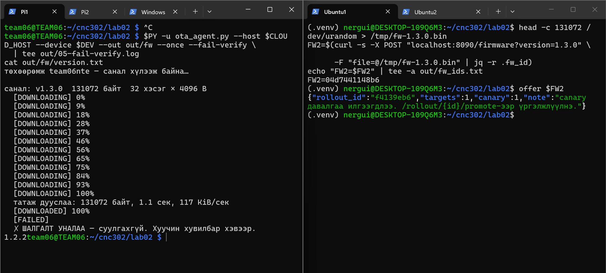

**Зураг 16.** Rollback ба SHA-256.

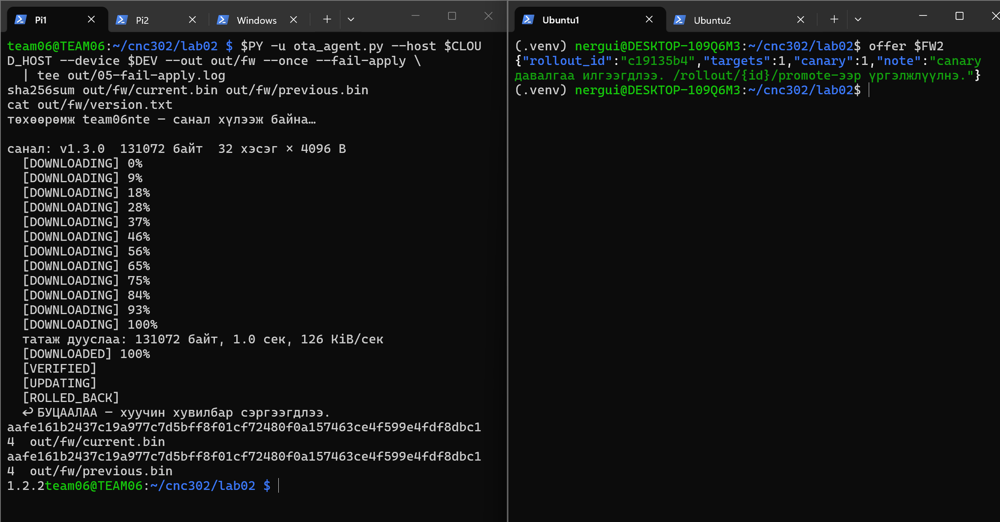

**Зураг 17.** Хэсэг алдагдал ба retry.

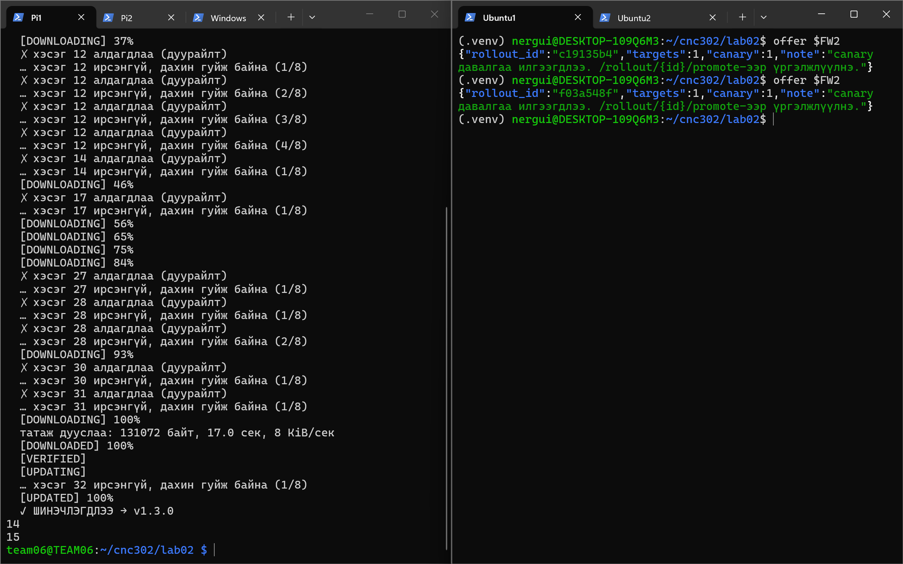

### 1.6 Canary тараалт

```bash
python provision.py bulk --count 20 --prefix ota --out out/ota.csv
```

```text
20 төхөөрөмж, 0.03 сек (1.6 мс/төхөөрөмж)
```

Компьютерт 20 агент ажиллуулж, `ota0019`, `ota0020` дээр `--fail-apply` тохируулсан. `jobs | wc -l` нь 20 байв. Canary хувь 20% буюу 4 төхөөрөмж.

```bash
curl -s localhost:8090/rollout/$RID | jq '.summary, .success_rate'
curl -s -X POST localhost:8090/rollout/$RID/promote | jq
```

```text
{"UPDATED":4,"pending":16}
20.0
{"rollout_id":"56adfa3f","promoted":16}
{"UPDATED":18,"ROLLED_BACK":2}
90.0
```

Эхний `20.0` нь нийт 20 төхөөрөмжийн 4 нь шинэчлэгдсэн хувь; canary бүлгийн амжилт өөрөө 4/4 = 100%.

Алдаатай төхөөрөмжүүдийг canary-ийн эхэнд байрлуулсан хоёр дахь оролдлогод:

```text
{"pending":20}
0.0
promote → HTTP 409
"running"
дахин promote → HTTP 409
```

Энэ нь дуусаагүй canary-г promote хийхээс татгалзсаны баримт. Canary дээр rollback илрээд тараалтыг зогсоосон гэж нотлохгүй.

**Зураг 18.** 20 агент.

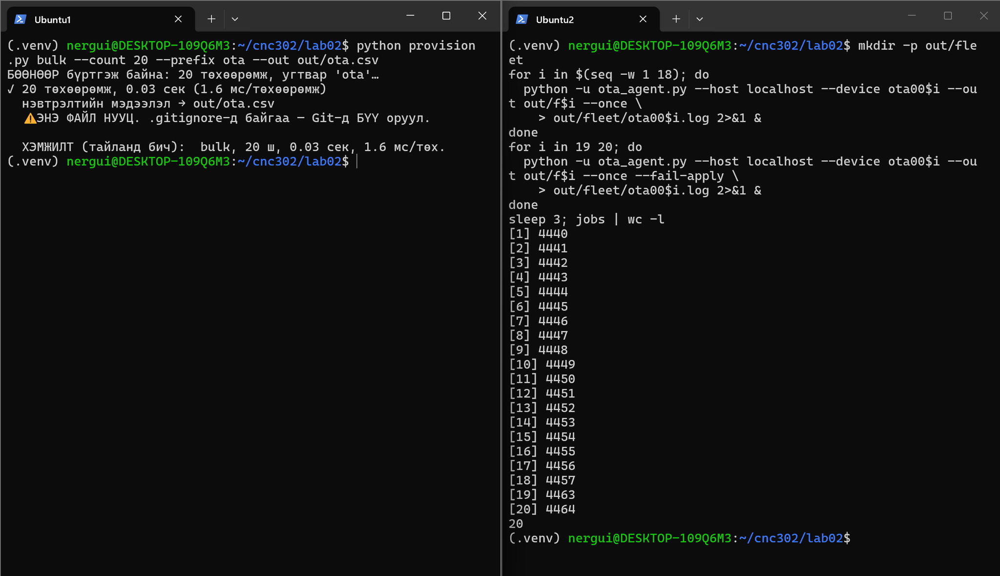

**Зураг 19.** Canary ба бүрэн rollout.

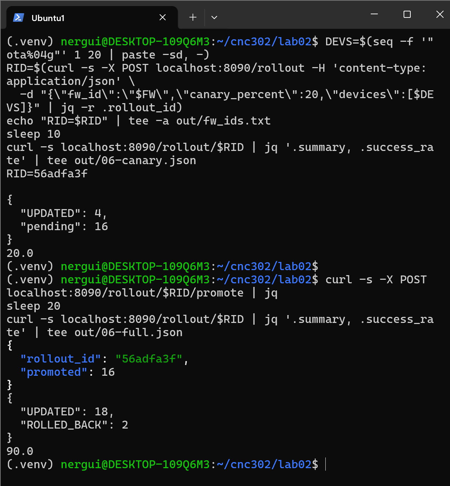

**Зураг 20.** Pending canary ба HTTP 409.

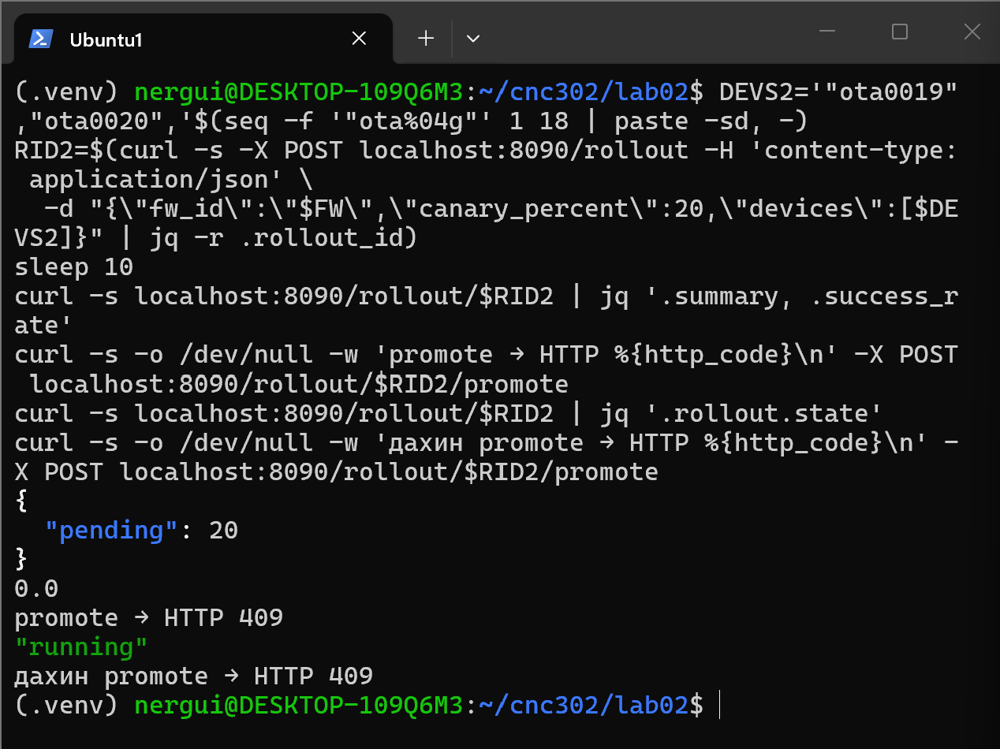

### 1.7 Хүчингүй болгох ба орчныг сэргээх

```text
authn enable=true → HTTP 204
```

`dev0001` нэр/нууц үгтэй холболт revoke хийхээс өмнө ч `not authorised`; нэргүй холболт `bad user name or password` болсон.

```bash
python provision.py revoke --device-id dev0001 | tee out/07-revoke.log
python provision.py list --state revoked
```

```text
dev0001 хүчингүй боллоо (EMQX хэрэглэгч: skipped)
Хөөсөн идэвхтэй холболт: skipped
dev0001  revoked  0.0.0
```

`dev0002`-ийг EMQX API-аар устгах хүсэлт HTTP 404; client жагсаалт `[]` байв. Түүний subscriber мөн холбогдож чадаагүй. Зурагт `PW2`-ыг `dev0001` мөрөөс уншсан нэмэлт алдаа байна.

Төгсгөлд:

```text
authn enable=false → HTTP 204
cnc302/shutis/mhts/lab/team06nte/bridge/state 1
```

**Зураг 21.** Authentication шалгалт.

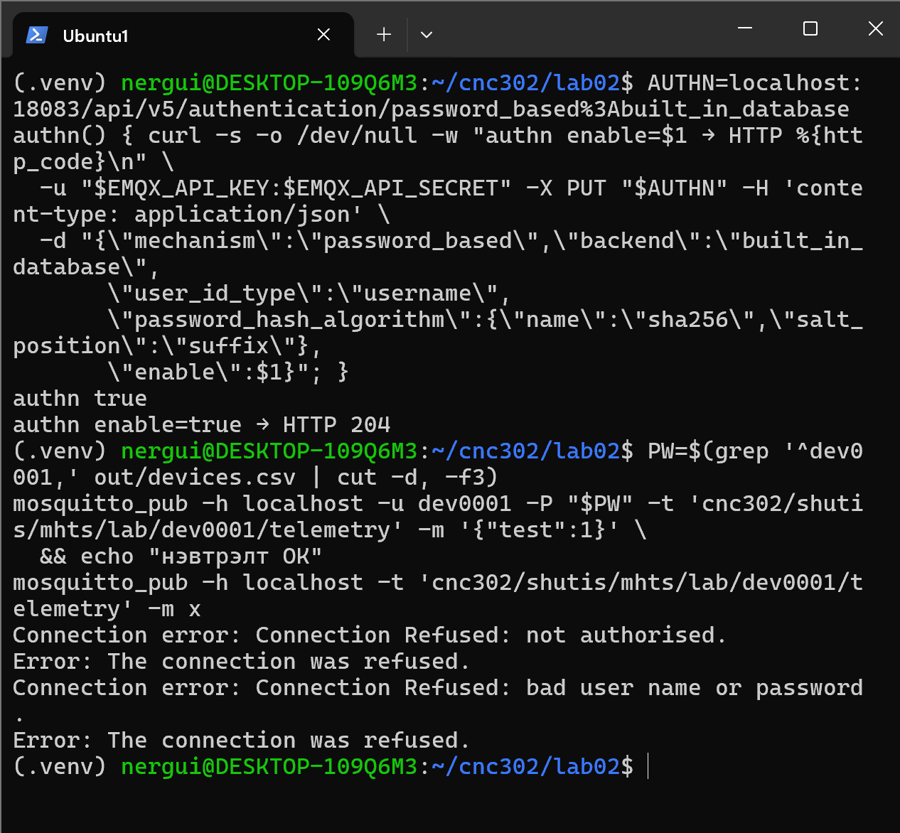

**Зураг 22.** Revocation skipped.

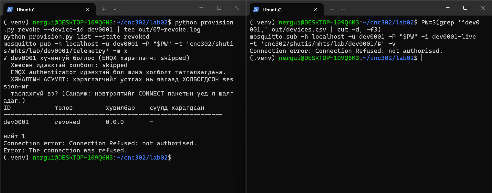

**Зураг 23.** Dev0002 ба HTTP 404.

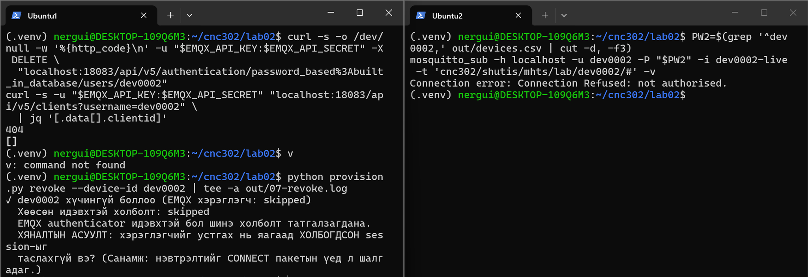

**Зураг 24.** Authenticator унтраах ба bridge.

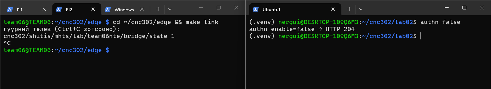

### 1.8 ThingsBoard

```bash
cd ~/cnc302/stack
time docker compose -f docker-compose.yml -f docker-compose.tb.yml \
  --profile core --profile tb up -d
docker stats --no-stream cnc302-thingsboard
```

```text
real 0m2.378s
CPU 6.78%
MEM USAGE / LIMIT 1.22GiB / 2.441GiB
MEM 49.95%
PIDS 269
```

ThingsBoard 3.9.1 вэб самбар нээгдсэн. `2.378 сек` нь Compose командын хугацаа; контейнер өмнө нь `Running` байсан тул cold start эсвэл UI бэлэн болох хугацаа биш. `sleep 180`-ийг `Ctrl+C`-ээр тасалсан тул бүтэн 180 сек хүлээсэн гэж тооцоогүй.

**Зураг 25.** ThingsBoard самбар.

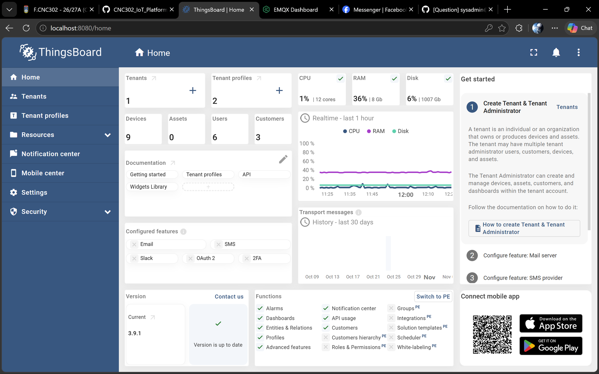

**Зураг 26.** ThingsBoard нөөц.

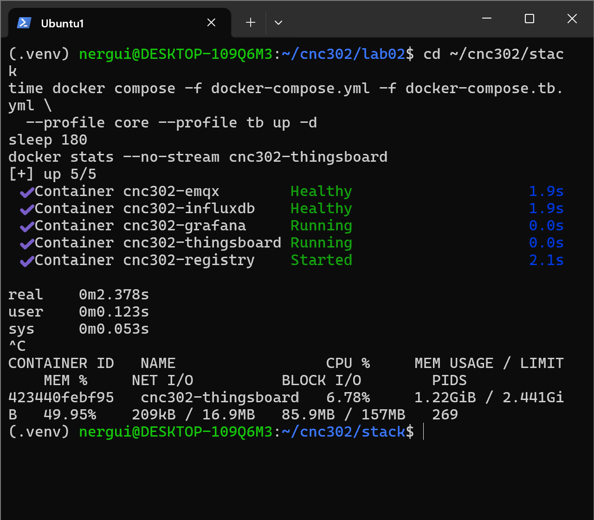

### 1.9 Тайлан ба Git-ийн бэлтгэл

```bash
cp docs/report-template.md lab02/report.md
code lab02/report.md
git add lab02/report.md
git status --short
git diff --cached --name-only | grep -E '\.crt$|\.key$|\.csv$|\.env$|fw_ids'
git ls-files | grep -E '\.crt$|\.key$|devices\.csv|\.env$'
```

Эцсийн зурагт тайлан болон зарим `.log`, `.json` файл staged болсон; хоёр нэрийн шалгалт гаралтгүй байв. Энэ нь зөвхөн файлын нэр/өргөтгөлийн шалгалт бөгөөд лог доторх нууц үг илрээгүй гэсэн баталгаа биш. Өмнөх `02-jit.log` гаралт нууц үг агуулж байсан тул нийтлэхийн өмнө агуулгыг нууцлах шаардлагатай. Commit, tag, push хийсэн гаралт ирээгүй. `01-bulk-fix.log` нэр харагдсан ч агуулгагүй тул EMQX алдаа засагдсан гэж дүгнээгүй.

---

**Зураг 27.** Git бэлтгэл ба файлын нэрийн шалгалт.

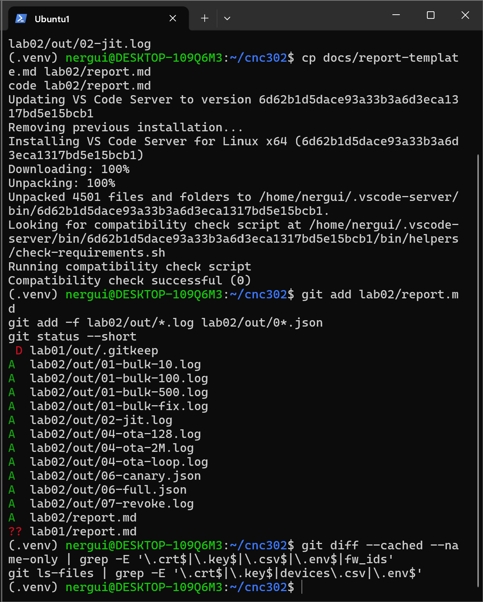

## 2. Хэмжилтийн үр дүн

### Хүснэгт 2.1 — Bulk бүртгэлийн хурд

| Төхөөрөмжийн тоо | Нийт хугацаа (сек) | мс/төхөөрөмж | Тэмдэглэл |
|---|---:|---:|---|
| 10 | 0.04 | 4.3 | CSV-д EMQX `skipped` батлагдсан |
| 100 | 0.03 | 0.3 | Ижил registry орчин; EMQX `created` баримтгүй |
| 500 | 0.03 | 0.1 | Ижил registry орчин; EMQX `created` баримтгүй |

Хугацаанууд нь программын хэвлэсэн тоймлосон утга. `0.03 × 1000 / 500 = 0.06 мс` нь нэг орны нарийвчлалаар `0.1 мс` болно.

### Хүснэгт 2.2 — Bulk vs JIT

| Шалгуур | Bulk | JIT | Багийн төсөлд санал болгох сонголт |
|---|---|---|---|
| Нэг төхөөрөмжийн хугацаа | 4.3 / 0.3 / 0.1 мс; EMQX бүрэн биш | Анхны 29.1 мс; давтан 21.8 мс; өөр нэр 26.9 мс | Хурдыг бүрэн EMQX бүртгэлтэйгээр дахин харьцуулах |
| Урьдчилсан бүртгэл | Флотын N төхөөрөмжийг урьдчилан үүсгэнэ | Анхны холболтоор үүсгэнэ; итгэмжлэх суурь урьдчилан хэрэгтэй | Хязгаарлагдмал багийн флотод bulk |
| Баталгаажуулалт | Нэвтрэлт үүсгэхээр төлөвлөсөн ч EMQX алхам алгассан | Туршилтад device_id-г баталгаагүйгээр хүлээж авсан | Төхөөрөмж тус бүрийн X.509 + mTLS |
| Хүчингүй болгох | Registry төлөв + EMQX хэрэглэгч + идэвхтэй холболт | Ижил зарчим; дахин JIT бүртгүүлэхийг мөн хориглоно | Сертификатын хүчингүй жагсаалт, ACL, session таслалт |

### Хүснэгт 2.3 — mTLS-ийн нэмэгдэл зардал

| Хэмжигдэхүүн | 1883 TLS-гүй | 8883 mTLS | Ялгаа | Эх баримт |
|---|---:|---:|---|---|
| CLI нийт хугацаа, мс | 68 | 231 | +163; +239.71% | `time mosquitto_pub`-ийн real |
| QoS 1 p50, мс | 180.452 | 366.585 | +186.133; +103.15% | 200 мессеж |
| QoS 1 p99, мс | 332.794 | 833.436 | +500.642; +150.44% | 200 мессеж |
| Pi CPU нийтлэх үед | Тусдаа хэмжилтгүй | Тусдаа хэмжилтгүй | Харьцуулах боломжгүй | Нэг `top` зурагт idle 97.3%; горим/үе нь тодорхойгүй |

`time mosquitto_pub` нь процесс эхлүүлэх, холбогдох, publish, disconnect бүх хугацааг агуулна; цэвэр TLS handshake хэмжилт биш.

| Нэмэлт үзүүлэлт | 1883 | 8883 |
|---|---:|---:|
| p95, мс | 327.829 | 817.102 |
| max, мс | 333.844 | 835.601 |
| Илгээсэн / ирсэн | 200 / 200 | 200 / 200 |
| Алдсан / давхар | 0 / 0 | 0 / 0 |
| Илгээх/сек | 9958.9 | 10592.1 |
| Хүлээн авах/сек | 600.7 | 243.7 |

**OpenSSL AES-128-GCM throughput:** эх гаралтын `k` нэгжийг хадгалав.

| Блокийн хэмжээ | Pi, kB/s | Компьютер, kB/s | Компьютер/Pi |
|---|---:|---:|---:|
| 16 B | 5863.89 | 95262.92 | 16.25× |
| 64 B | 15135.79 | 366082.33 | 24.19× |
| 256 B | 27180.89 | 1281235.46 | 47.14× |
| 1024 B | 32944.37 | 3489074.86 | 105.91× |
| 8192 B | 35315.71 | 7163374.25 | 202.84× |
| 16384 B | 34466.47 | 7742160.90 | 224.63× |

Pi CPU features: `fp asimd evtstrm crc32 cpuid`; `aes`, `sha2` харагдаагүй. Компьютерийн CPU flags ирээгүй учраас аппаратын хурдатгалыг шууд батлаагүй.

### Хүснэгт 2.4 — OTA гүйцэтгэл

| Зам — 512 KiB, 128 хэсэг | Таталтын хугацаа, сек | KiB/сек | Хэсэг/сек, тооцоолсон | Тэмдэглэл |
|---|---:|---:|---:|---|
| Pi → үүл шууд LAN | 5.3 | 97 | ≈24.15 | UPDATED |
| Pi → гүүрээр | Баримт ирээгүй | Баримт ирээгүй | Тооцоогүй | Bridge state 1 нь OTA гүүрээр хэмжсэн гэсэн үг биш |
| Компьютер loopback, эхний | 0.2 | 2554 | ≈640 | UPDATED |
| Компьютер loopback, давтан | 0.2 | 2743 | ≈640 | UPDATED; хугацаа 0.1 сек-ийн нарийвчлалаар хэвлэгдсэн |

Хэсэг/сек-ийг хэвлэгдсэн хугацаанаас тооцсон тул loopback мөрийн алдаа харьцангуй их байж болно. KiB/сек нь логийн эх утга. Эдгээр хугацаа нь татаж дуусах хүртэлх хугацаа; apply болон нийт OTA хугацааг тусад нь хэмжээгүй.

| Хэмжээ | Хэсэг | Таталтын хугацаа, сек | KiB/сек | Эцсийн төлөв |
|---|---:|---:|---:|---|
| 128 KiB | 32 | 1.1 | 118 | UPDATED → 1.2.1 |
| 512 KiB | 128 | 5.3 | 97 | UPDATED → 1.2.0 |
| 2 MiB | 512 | 21.8 | 94 | UPDATED → 1.2.2 |

### Хүснэгт 2.5 — Эвдрэлийн хариу үйлдэл

| Хувилбар | Эцсийн төлөв | Таталтын хугацаа, сек | Алдагдсан хэсэг | Дахин хүсэлт | Хуучин хувилбар |
|---|---|---:|---|---|---|
| Хэвийн 512 KiB | UPDATED | 5.3 | Гаралтад алдагдалгүй | Retry харагдаагүй | Шинэ 1.2.0 суусан; өмнөх backup нотолгоогүй |
| `--fail-verify`, 128 KiB | FAILED | 1.1 | Гаралтад алдагдалгүй | Retry харагдаагүй | 1.2.2 хэвээр |
| `--fail-apply`, 128 KiB | ROLLED_BACK | 1.0 | Гаралтад алдагдалгүй | Retry харагдаагүй | 1.2.2 сэргэсэн; хоёр hash ижил |
| Хэсэг алдагдуулах, 128 KiB | UPDATED | 17.0 | 14 тохиолдол, 10 ялгаатай хэсэг | 15 мөр; таталтын үед 14, UPDATING үед нэмэлт 1 | 1.3.0 суусан; backup шалгалт ирээгүй |

Нэмэлтээр ирүүлсэн бүтэн логийг тоолоход 2, 6, 8, 12, 14, 17, 27, 28, 30, 31 гэсэн 10 ялгаатай хэсэг дээр нийт 14 алдагдлын тохиолдол байна. 12-р хэсэг дөрөв, 28-р хэсэг хоёр удаа алдагдсан. Таталтын үед 14 retry, UPDATING үед «хэсэг 32» гэсэн нэмэлт нэг retry мөр гарсан тул нийт 15. 32 хэсгийн индекс 0–31 байх үед энэ нэмэлт мөрийг бодит 33 дахь өгөгдлийн хэсэг алдагдсан гэж үзэхгүй; агентын төлөв шилжилт/timeout логийг цааш шалгах шаардлагатай. `--drop-rate 0.2` параметрийн командын мөр ирээгүй.

### Хүснэгт 2.6 — Canary тараалт

| Давалгаа | Төхөөрөмж | UPDATED | FAILED / ROLLED_BACK | Бүлгийн амжилт | Хугацааны баримт |
|---|---:|---:|---:|---:|---|
| Canary 20% | 4 | 4 | 0 | 100% | `sleep 10`-ын дараах шалгалт; бодит дуусах хугацаа хэмжээгүй |
| Үлдсэн 80% | 16 | 14 | 2 ROLLED_BACK | 87.5% | Promote-оос хойш `sleep 20`-ын дараах шалгалт |
| Нийт | 20 | 18 | 2 ROLLED_BACK | 90% | Нийт OTA хугацаа тусад нь хэмжээгүй |

Үлдсэн бүлгийн 14 UPDATED нь нийт 18-аас эхний canary-ийн 4-ийг хассан тооцоо. Хоёр дахь оролдлого: `pending=20`, амжилт 0%, promote хоёр удаа HTTP 409, rollout төлөв `running`.

### Хүснэгт 2.7 — Хүчингүй болгох

| Асуулт | Хариу |
|---|---|
| Шинэ холболт татгалзсан уу? | Тийм. Гэхдээ revoke-оос өмнө ч татгалзсан тул revoke үйлдлийн үр нөлөөг дангаар нотлоогүй. |
| Одоо байгаа session тасарсан уу? | Батлагдаагүй. Subscriber анхнаасаа холбогдоогүй; client жагсаалт `[]`; kick нь `skipped`. |
| Хэдэн секундын дараа тасарсан бэ? | Хэмжих идэвхтэй session үүсээгүй тул хэмжигдээгүй. |
| X.509-д CRL/OCSP хэрэгтэй юу? | Хугацаа дуусаагүй сертификатыг хүчингүй болгохын тулд CRL зэрэг revocation шалгалт эсвэл дэмжигдсэн өөр механизм хэрэгтэй. Username устгах нь сертификатыг автоматаар хүчингүй болгохгүй. |

### Хүснэгт 2.8 — Registry ба ThingsBoard

| Шалгуур | Registry | ThingsBoard |
|---|---|---|
| RAM | Тусдаа хэмжилт ирээгүй | 1.22 GiB ≈1249.28 MiB; эх утга тоймлосон |
| Эхлэх хугацаа | Тусдаа хэмжилт ирээгүй | Cold start хэмжээгүй; Compose up команд 2.378 сек |
| Кодын мөр | Зааварт ≈500; `wc -l` хэмжилт ирээгүй | Тооцоолсон баримт ирээгүй |
| Pi 3B дээр ажиллах уу? | Энэ туршилтад компьютер дээр ажилласан; Pi дээр батлаагүй | Ажигласан RAM хэрэглээ нь Pi-ийн 905 MiB нийт RAM-аас давсан тул энэ тохиргоог Pi дээр ажиллуулах үндэслэлгүй |
| Rule engine, UI, олон түрээслэгч | Лабын хязгаарлагдмал registry | Самбар нээгдсэн; tenants, devices, dashboard боломж харагдсан |
| Протоколыг судлах боломж | Лабын жижиг кодыг уншиж туршихад хялбар | Нээлттэй эхтэй боловч платформын дотоод хэрэгжилт илүү өргөн |

---

## 3. Дүгнэлт

1. **Бүртгэл ба брокерийн нэвтрэлт өөр шат болох нь харагдав.** Registry-д 10–500 төхөөрөмжийг 0.03–0.04 секундэд бүртгэсэн боловч CSV-д `skipped`, revoke үед мөн `skipped` гарсан. Иймээс эдгээр хугацаа нь бүрэн EMQX нэвтрэлттэй provisioning-ийн хүчин чадлыг төлөөлөхгүй. Багийн системд registry–broker интеграцыг тусад нь шалгах шаардлагатай.
2. **mTLS холболтын шалгалт ажилласан.** Зөв сертификаттай үед CONNACK 0, сертификатгүй болон өөрөө зурсан сертификаттай үед татгалзсан. Тухайн QoS 1 туршилтад p99 нь 332.794-өөс 833.436 мс болж 150.44%-иар өссөн; хоёр горимд 200/200 мессеж хүрсэн. Энэ нь нэг удаагийн сүлжээ, burst ачаалалтай хэмжилт тул өсөлтийг бүхэлд нь криптографийн тооцооллоос болсон гэж дүгнэхгүй.
3. **OTA-ийн таталтын хугацаа том файл дээр хэмжээтэй ойролцоо пропорционал өссөн.** 512 KiB → 2 MiB хэмжээ 4 дахин, хугацаа 5.3 → 21.8 сек буюу 4.11 дахин өссөн. LAN хурд 94–118 KiB/сек байв. 512 KiB loopback 0.2 сек байхад LAN 5.3 сек байгаа нь сүлжээ ба хэсэг тус бүрийн хүсэлт-хариуны хүлээлтийг судлах үндэслэл болно.
4. **Шалгалт ба rollback нь хуучин ажиллах хувилбарыг хамгаалсан.** Verify алдаанд 1.2.2 хэвээр; apply алдаанд 1.2.2 сэргэсэн ба current/previous hash ижил байв. Алдагдал дуурайлгасан туршилт 17.0 секундэд 1.3.0 руу шинэчлэгдсэн нь retry ажилласныг харуулсан.
5. **Canary бүх алдааг илрүүлэх баталгаа биш.** Эхний 4 төхөөрөмж 100% амжилттай байсан ч дараагийн 16-аас 2 нь rollback хийж нийт амжилт 90% болсон. Туршилтын бүлэгт төхөөрөмжийн төрөл, сүлжээ, firmware хувилбарын ялгааг төлөөлүүлэх шаардлагатай.
6. **Хүчингүй болгох туршилт дутуу баталгаажсан.** Registry-ийн revoked төлөв батлагдсан боловч ажиллаж буй session-ийг таслах болон EMQX хэрэглэгч устгах алхам батлагдаагүй. ThingsBoard-ын 1.22 GiB хэрэглээ нь cloud үйлчилгээг компьютерт, edge агентыг Pi дээр ажиллуулах архитектурыг дэмжиж байна.

---

## 4. Хяналтын асуултын хариулт

### 1. Bulk шугаман өссөн үү? 100 000 төхөөрөмжид хэдий хугацаа хэрэгтэй, яаж хурдасгах вэ?

Үгүй: 10, 100, 500 төхөөрөмжийн хугацаа 0.04, 0.03, 0.03 сек байсан. EMQX бүртгэл алгассан, нэг удаагийн богино хугацаатай үр дүн учраас бодит provisioning-ийг шууд extrapolate хийх боломжгүй. Зөвхөн registry-only нөхцөлд 500 төхөөрөмжийн тоймлосон 0.03 сек-ийг шугаман гэж түр үзвэл `100000/500 × 0.03 = 6 сек` болно. Энэ нь баталгаатай таамаг биш; хэвлэгдсэн 0.1 мс/төхөөрөмжийг ашиглавал тоймлолтоос 10 сек гарна.

Хурдасгах хоёр арга: (1) өгөгдлийн сангийн INSERT-ийг batch/нэг transaction-аар хийх — одоогийн код энэ аргыг ашигладаг; (2) EMQX API хүсэлтүүдийг хязгаарласан зэрэгцээ worker, connection reuse-ээр боловсруулах, broker дэмжвэл batch API хэрэглэх. Rate limit, retry ба давтан бүртгэлийн аюулгүй ажиллагааг хадгална.

### 2. JIT-ийн эмзэг байдлыг X.509-ээр хэрхэн хаах вэ? Хувийн түлхүүрийг яаж хамгаалах вэ?

JIT endpoint төхөөрөмжийн сертификатын CA chain, хугацаа, clientAuth зориулалт, хүчингүй төлөвийг шалгаж, баталгаажсан сертификатын identity-г хүсэлтийн device_id-тай тулгана. Зөвхөн MQTT-ийн 8883 портыг mTLS болгох нь HTTP JIT endpoint-ийг автоматаар хамгаалахгүй. Өмнө бүртгэсэн төхөөрөмжийн нууц үгийг зөвхөн нэрийг нь хэлсэн этгээдэд дахин буцааж болохгүй.

Pi дээр private key-г зориулалтын хэрэглэгчид эзэмшүүлж `chmod 600` хийх, CA private key-г Pi рүү хуулахгүй байх, нууц файлыг Git-д оруулахгүй байх шаардлагатай. TPM/Secure Element байхгүй үед root эрх эсвэл SD картын физик хандалттай этгээд түлхүүрийг хуулж авах эрсдэл үлдэнэ. Илүү өндөр хамгаалалтад тусдаа secure element болон түлхүүр солих/хүчингүй болгох бодлого хэрэгтэй.

### 3. mTLS саатал хэдэн хувиар өссөн, AES хурд хэр ялгаатай, 1000 төхөөрөмжид ямар нөлөөтэй вэ?

p50 өсөлт 103.15%, p99 өсөлт 150.44%; CLI real хугацааны өсөлт 239.71%. Pi features-д `aes`, `sha2` байгаагүй. OpenSSL AES-128-GCM дээр компьютер 16 B блокт 16.25 дахин, 16 KiB блокт 224.63 дахин хурдан байсан. Энэ нь AES throughput харьцуулалт болохоос MQTT throughput эсвэл TLS handshake-ийн шууд харьцаа биш.

1000 төхөөрөмжийг нэг дор дахин холбох нь broker-ийн handshake ачааллыг өсгөнө. Удаан хадгалах холболт, үе шаттай reconnect, jitter/backoff ашиглах нь тохиромжтой. Нэг төхөөрөмжийн p99-ийг 1000-аар үржүүлж флотын latency гэж тооцож болохгүй; зэрэгцээ ачааллын тусдаа хэмжилт шаардлагатай.

### 4. OTA хугацаа хэмжээтэй шугаман өссөн үү? 4 KiB → 64 KiB хэсэг болговол?

512 KiB-аас 2 MiB хүртэл хугацаа хэмжээтэй ойролцоо пропорционал өссөн (4× хэмжээ, 4.11× хугацаа). 128 KiB-аас 512 KiB хүртэл 4× хэмжээ боловч 4.82× хугацаа тул бүх цэгийг яг шугаман гэж хэлэхгүй.

Хэрэв гол хязгаарлагч нь нэг хэсэг бүрийн round-trip бол 512 KiB файлын хүсэлтийн тоо 128-аас 8 болж 16 дахин буурна. Гэхдээ нийт хугацаа заавал 16 дахин багасахгүй. Том хэсэг нь буфер/RAM хэрэглээ, нэг алдагдалд дахин дамжуулах байт, MQTT packet limit болон сүлжээний саатлын нөлөөг нэмэгдүүлнэ.

### 5. ESP32 дээр rollback хэрхэн хийгдэх вэ? A/B хэдэн хувь илүү flash хэрэгтэй вэ?

Ердийн A/B загварт шинэ image-ийг идэвхгүй application partition-д бичиж шалгаад boot сонголтыг шилжүүлнэ. Шинэ firmware self-test-ээ давсны дараа хүчинтэй гэж батална; амжилтгүй бол bootloader өмнөх хүчинтэй slot-д буцна. Лабын `previous.bin` хуулбар нь энэ санааны файл дээрх дуурайлт юм.

Нэг image-ийн багтаамж F бол хоёр slot 2F тул application image хадгалах хэсэгт ойролцоогоор 100% нэмэлт зай хэрэгтэй. Bootloader, NVS, metadata зэргийг оролцуулсан нийт flash яг 100% өснө гэсэн үг биш.

### 6. 5000 төхөөрөмжийн 20% = 1000 нь хэт олон уу?

Шинэ firmware-ийн эрсдэл өндөр, алсаас сэргээх боломж муу үед 1000 төхөөрөмжийг эхний бүлэг болгох нь том эрсдэл. Бүлгийн хэмжээг алдааны өртөг, төлөөлөх hardware/software хувилбар, сүлжээний ялгаа, rollback чадвар, ажиглалтын хугацаа, амжилтын босгоор сонгоно. Лабт 4/4 canary амжилттай ч нийт 18/20 болсон тул canary-ийн хувь төдийгүй бүрэлдэхүүн чухал. Жижиг төлөөлөх pilot-оос эхэлж, үр дүнгээр давалгааг томруулах нь үндэслэлтэй.

### 7. Хэрэглэгч устгасан ч session яагаад үлдэж болох вэ? MQTT 5.0 яаж туслах вэ?

Нэр/нууц үгийн шалгалт CONNECT үед хийгддэг бол хэрэглэгчийг устгах нь одоо нээлттэй TCP/MQTT холболтыг автоматаар хаахгүй. Идэвхтэй халдагч publish/subscribe үргэлжлүүлж болох тул broker-оос холболтыг хөөх, дахин нэвтрэх эрхийг хаах хоёр үйлдэл хэрэгтэй. Манай зургууд энэ ялгааг бодитоор туршиж батлаагүй: эхний subscriber холбогдоогүй, kick `skipped` байсан.

Username-аар хөөх нь өөр identity-тай X.509 клиентүүдийг бүрэн хамрахгүй байж болно. Сертификатын identity–client mapping, ACL, сертификат хүчингүй болгох бодлого хэрэгтэй. Серверээс `DISCONNECT` илгээх нь идэвхтэй холболтыг хаахад тусална. `Session Expiry Interval` нь салсны дараах session өгөгдөл хадгалах хугацааг удирддаг болохоос идэвхтэй холболтыг өөрөө хүчингүй болгох механизм биш.

---

## 5. Тулгарсан асуудал ба шийдэл

| Асуудал | Шалтгаан | Шийдсэн арга / цааш хийх зүйл | Хугацаа |
|---|---|---|---|
| Bash `bad substitution` | `${}` гэсэн буруу хувьсагчийн бичиглэл | `${EMQX_API_KEY:-}` болгон зассан; дараа нь хоосон key илэрсэн | Хэмжээгүй |
| OTA санал Pi-д чиглэхгүй | Ubuntu `pi3b-team06`, Pi `team06nte` | Ubuntu дээр `export DEV=team06nte`; дахин санал өгсний дараа LAN OTA UPDATED болсон | Хэмжээгүй |
| CSV `emqx=skipped` | Registry талд EMQX API key тохируулагдаагүй гэсэн гаралт | Засагдсан баримтгүй. Контейнерийн env дамжуулалтыг шалгаж шинэчлэн үүсгээд шинэ prefix-ээр `created` эсэхийг шалгана | Шийдэгдээгүй |
| Verify дуурайлтын FAILED | Зориудаар checksum шалгалтыг унагасан | Шинэ firmware суулгаагүй; 1.2.2 хэвээр | Таталт 1.1 сек |
| Apply дуурайлтын алдаа | `--fail-apply` | Өмнөх binary сэргэсэн, hash ижил | Таталт 1.0 сек |
| OTA хэсэг алдагдах | Зориудын loss дуурайлт | Retry хийж 1.3.0 болгон шинэчилсэн | Таталт 17.0 сек |
| Хоёр дахь canary pending 20 | Агент санал аваагүй/дуусаагүй; `--once` агент өмнөх ажлаар гарсан байх боломжтой | Шалтгаан бүрэн батлагдаагүй. Агентуудыг дахин асааж, canary rollback төлөвтэй болсны дараа promote шалгана | Шийдэгдээгүй |
| Revocation `skipped`, хэрэглэгч устгах 404 | EMQX хэрэглэгч бүртгэл үүсээгүй байдалтай нийцэж байна | Эхлээд зөв хэрэглэгчээр нэвтрэлт OK ба live session батлаад revoke-ийг дахин хэмжинэ | Шийдэгдээгүй |
| `dev0002` нууц үг буруу сонгосон | `PW2`-д `dev0001` мөрийг уншсан | `grep '^dev0002,' out/devices.csv` ашиглах шаардлагатай; зассан гаралт ирээгүй | Шийдэгдээгүй |
| Authenticator-ийн дараа edge холболт | Туршилтаар authentication асаасан | `authn false` → HTTP 204; bridge/state 1 | Хэмжээгүй |
| ThingsBoard cold start тодорхойгүй | Өмнө нь ажиллаж байсан контейнерт Compose up хийсэн | 2.378 сек-ийг зөвхөн командын хугацаа гэж тайлагнасан | 2.378 сек |

---

## 6. Ашигласан эх сурвалж

1. [BatdalaiS/CNC302_IoT_Platform — Лаб 2-ын заавар](https://github.com/BatdalaiS/CNC302_IoT_Platform/blob/main/lab02/README.md). 2026-11-05-нд уншив. Хүснэгт 2.1–2.8, алхмууд, хяналтын 7 асуулт, шаардлагыг ашиглав. Уншсан README blob: `256b0187dc2d82cc412ed74ed9495c7549a813b5`; энэ нь багийн туршилтын commit биш.
2. TEAM-06-ийн ирүүлсэн терминал ба ThingsBoard-ын дэлгэцийн зургууд. Тайлангийн бодит тоон үр дүн, команд, алдаа, төлөвийн эх баримт.
3. Лабын зааварт холбосон нэмэлт баримтууд: [EMQX 5.8 REST API](https://docs.emqx.com/en/emqx/v5.8/guides/api.html), [EMQX TLS](https://docs.emqx.com/en/emqx/v5.8/guides/network/emqx-mqtt-tls.html), [EMQX CRL](https://docs.emqx.com/en/emqx/v5.8/guides/network/crl.html), [Mosquitto publish CLI](https://mosquitto.org/man/mosquitto_pub-1.html). Эдгээрийг цааш баталгаажуулах холбоос болгон оруулав; энэ тайлан боловсруулахдаа тус бүрийг бие даан нээж шалгаагүй.
4. **Хиймэл оюуны туслах:** ChatGPT, 2026-11-05. Зургаас команд/гаралт буулгах, хүснэгт нэгтгэх, хувь ба харьцаа тооцох, хяналтын хариулт боловсруулахад ашиглав. Тоонуудыг ирүүлсэн зургуудтай тулгаж, тооцоог скриптээр шалгасан. AI нь Pi дээр туршилтыг дахин ажиллуулаагүй. Баг эцсийн тайланг эх лог болон төхөөрөмжийн орчинтой тулгаж баталгаажуулах шаардлагатай.

---

## 7. Хэмжилтийн файлууд ба нотлох зургууд

Зургуудад харагдсан командын дагуу үүссэн/заасан файлууд; бодит файлын агуулгыг энэ тайлантай хамт хүлээн аваагүй. Доорх файлуудыг энэ тайлангаар Git-д нэмээгүй.

| Байрлал | Файлууд / зориулалт |
|---|---|
| `lab02/out/` | `01-bulk-10.log`, `01-bulk-100.log`, `01-bulk-500.log`, `01-bulk-fix.log` (сүүлийн файлын агуулга ирээгүй) |
| `lab02/out/` | `02-jit.log` — нууц үг агуулж болзошгүй |
| `lab02/out/` | `03-lat-1883.csv`, `03-lat-1883.log`, `03-lat-8883.csv`, `03-lat-8883.log` |
| `lab02/out/` | `04-ota-loop.log`, `04-ota-lan.log`, `04-ota-128k.log` (туршилтын зураг), `04-ota-128.log` (Git status), `04-ota-2M.log`; 128 KiB логийн нэрийг эцэслэн тулгана |
| `lab02/out/` | `05-fail-verify.log`, `05-fail-apply.log`; loss туршилтын логийн нэр зурагт харагдаагүй |
| `lab02/out/` | `06-canary.json`, `06-full.json`, `07-revoke.log` |
| `lab02/out/fleet/` | `ota0001.log`–`ota0020.log` |
| `lab02/out/` | `devices.csv`, `b100.csv`, `b500.csv`, `ota.csv` — төхөөрөмжийн нууц мэдээлэлтэй |
| `lab02/out/` | `fw_ids.txt` — туршилтын firmware/rollout ID |
| `lab02/out/fw/` | `current.bin`, `previous.bin`, `version.txt` |
| `lab02/certs/` | `ca.crt`, `server.crt`, `server.key`, `pi3b-team06.crt`, `pi3b-team06.key`, `dev0001.crt` зэрэг сертификатын материал; Git-д нэмэхгүй |

Энэ багцад 27 нотлох зураг `images/` хавтаст орсон. Нууц үг ил гарсан JIT/CSV зургуудыг багцад оруулаагүй; холбогдох гаралтыг тайланд нууцалсан текстээр тусгав. Хэмжилтийн raw лог, CSV, private key багцад байхгүй.

### Хавсралт — Багийн таних тэмдгийн стратеги

Багийн флотод төхөөрөмж тус бүрийг давтагдахгүй device_id, тусдаа X.509 сертификат, тусдаа private key-тай байхаар төлөвлөнө. Жижиг, урьдчилан мэдэгдсэн төхөөрөмжүүдийг bulk бүртгэж, төхөөрөмж нэмэгдэх үед зөвхөн баталгаажсан сертификаттай JIT хүсэлт зөвшөөрнө. Registry, сертификатын identity болон MQTT topic-ийн device_id-г нэг утгаар уялдуулна. Лабт `pi3b-team06` ба `team06nte` зөрсөн тул энэ зураглалыг автоматаар шалгах хэрэгтэй.

Төхөөрөмж зөвхөн өөрийн telemetry/state topic руу publish, өөрийн command/OTA topic-оос subscribe хийх ACL-тай байна. Итгэмжлэгдсэн CA сертификаттай байх нь бусад төхөөрөмжийн topic руу нэвтрэх эрхийг дангаараа олгохгүй. CA private key-г төхөөрөмжөөс тусад нь хадгалж, төхөөрөмжийн key-г хамгийн бага файлын эрхтэй хамгаална. Сертификатын хугацаа дуусахаас өмнө шинэчлэх болон төхөөрөмж алдагдсан үед registry revoke, broker kick, сертификат хүчингүй болгох үйлдлийг нэг ажиллагаа болгоно.

OTA-д checksum-оос гадна firmware-ийн үйлдвэрлэгчийн тоон гарын үсгийг шалгахыг үйлдвэрлэлийн шаардлагад оруулна: hash нь файлын бүрэн бүтэн байдлыг шалгах боловч итгэлгүй эх үүсвэрийн firmware-ийг дангаараа танихгүй. Шинэчлэлтийг төлөөлөх canary бүлэгт эхлүүлж, алдаа/rollback илэрвэл дараагийн давалгааг зогсооно. Шинэ firmware өөрийгөө шалгаж баталгаажуулах хүртэл өмнөх ажиллах image-ийг хадгална.

### Тайланг эцэслэхэд үлдсэн баталгаажуулалт

- Багийн бодит ажлын хуваарилалт, туршилтын commit ба tag.
- Орчны загвар/CPU, OS/kernel, Docker, RAM available, microSD ба сүлжээний хурд; хэмжилтийн өмнөх Pi шалгалтууд.
- EMQX `created` болсон bulk болон идэвхтэй session-тэй revoke-ийн дахин туршилт.
- Pi → гүүрээр OTA хугацаа, loss туршилтын командын параметр, canary rollback-оос шалтгаалсан promote хоригийн баримт.
- Registry-ийн RAM, шаардлагатай бол үйлчилгээний бодит cold start хэмжилт.
